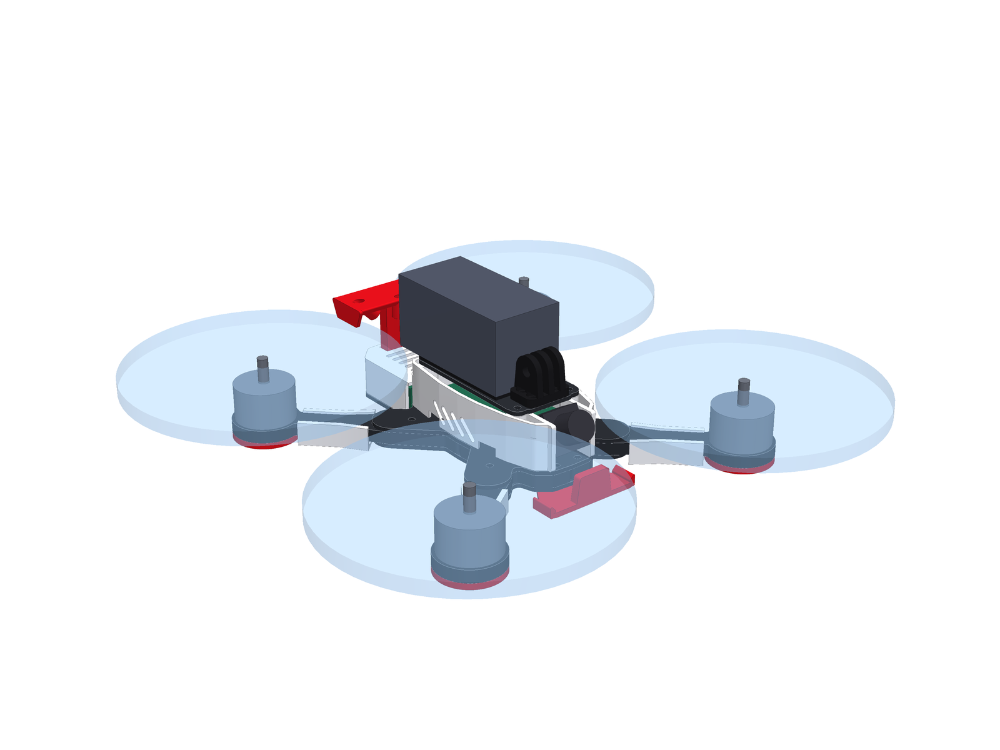
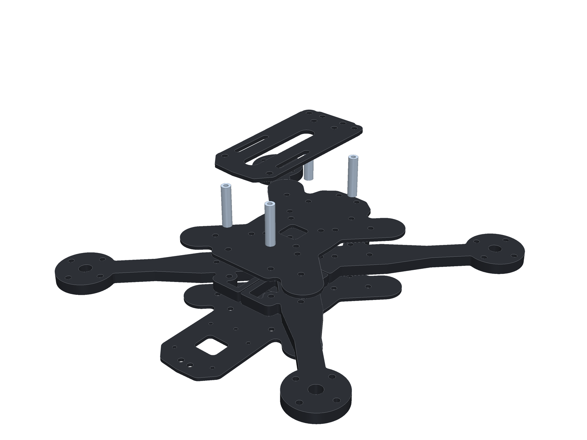
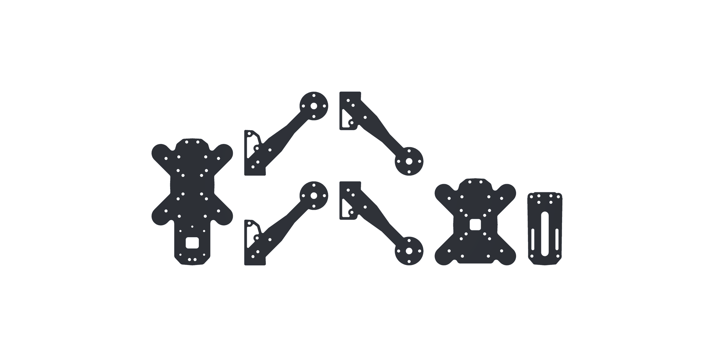
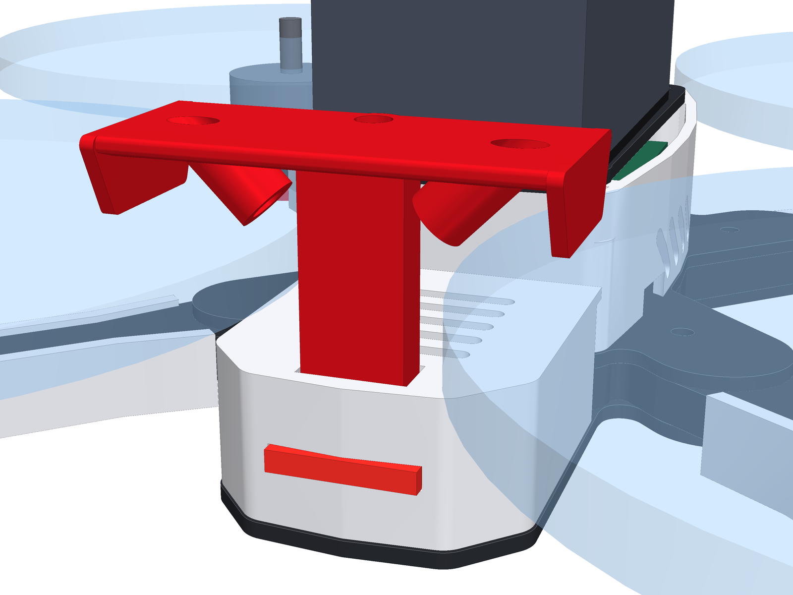
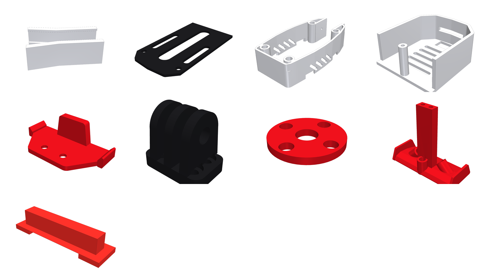

# Bolid 5"

Фрістайл-рама 5" у стилі суперкара: чистий білий кузов, жодного видимого гвинта, дроти сховані.
Під кузовом — розрахована рама: **компактна (маневреність)** і з **променями рівної міцності** (міцність).

Окремий проєкт: власна геометрія, розрахунок і перевірки. Інструменти рендеру, перевірки друку та
експорту взяті з Vektor 7.5" (це моя ж інфраструктура); дизайн рами — новий.



## Головне

| | |
|---|---|
| Пропи | 5.1" (129.5 мм), зазор між кінцями 21.8 мм |
| База | 214 мм, справжній X |
| Мотори | 2207 / 2306, 16×16 M3 |
| Промені | 4 окремі, 6 мм, змінна ширина 20 → 12 мм |
| Плити | нижня 2 мм, притискна 2 мм, верхня 2 мм |
| Карбон | 135 г (+ 3.5 г алюмінієвих стійок) |
| Стек | 30.5 і 20×20, відсік 22 мм |
| Відео | цифровий VTX 30×30 у хвості, камера 19 мм, нахил 20–50° |
| Батарея | 6S 1100–1300 (35×70×35), на даху |

## Чому так

### Маневреність: найменша безпечна база

**Висновок:** 214 мм — це найменша база, де між кінцями пропів лишається ≥ 20 мм (мінімум 211.4 мм плюс
~2.6 мм запасу на прогин пропа).

Ментальна модель: чим ближче мотори до центру, тим менший момент інерції. Тоді квадрик швидше
починає фліп і рол. Але якщо пропи надто близько, вони працюють у потоці один одного.

| База, мм | Зазор пропів, мм | Прискорення фліпу | Інерція по рисканню |
|---:|---:|---:|---:|
| 200 | 11.9 | 1.04 | 0.88 |
| 210 | 19.0 | 1.01 | 0.97 |
| **214** | **21.8** | **1.00** | **1.00** |
| 225 | 29.6 | 0.97 | 1.10 |
| 240 | 40.2 | 0.92 | 1.24 |

Для порівняння: типова 5" рама на 225 мм — на ~3 % повільніша у фліпі й на ~10 % «важча» по рисканню.
Різниця невелика: це модель твердого тіла з типовими масами (мотор 40 г, корпус 520 г).

### Міцність: промінь рівної міцності

**Висновок:** при тій самій масі, що й у прямого променя 14 мм, звужений промінь витримує на **43 %**
більше вертикального удару і на **23 %** більше бокового. За вертикальною міцністю він рівний
повному 20 мм променю, але легший за нього на 32 %.

Ментальна модель: згинальний момент від удару по мотору найбільший там, де промінь виходить із плит, і
падає до нуля біля мотора. Тож ширина променя теж падає разом із моментом. Карбон є там, де він працює.

| Промінь (вільна частина) | г | Жорсткість ↑, Н/мм | Сила ↑, Н | Сила вбік, Н | 1-а частота, Гц |
|---|---:|---:|---:|---:|---:|
| прямий 14 мм | 7.7 | 221 | 854 | 1993 | 366 |
| прямий 20 мм | 11.0 | 316 | 1220 | 4068 | 433 |
| **звужений 20 → 12 мм (Bolid)** | **7.5** | **239** | **1220** | **2445** | **381** |
| звужений, 5 мм завтовшки | 6.2 | 138 | 847 | 2037 | 291 |

Повна таблиця: `exports/analysis/studies.txt`.

Компроміси й обмеження:

- **Боком** звужений промінь слабший за повний 20 мм (2445 Н проти 4068 Н). Ламатиметься він не біля
  плит, а там, де закінчується звуження (u = 72 мм).
- 5 мм завтовшки — на 1.3 г легше на промінь, але на 31 % слабше. Лишив 6 мм.
- Модель — балка Ейлера–Бернуллі, E = 60 ГПа, міцність 600 МПа. **Фізичним тестом не перевірено.**

### Корені променів замикаються

Кожен промінь заходить коренем у свою чверть корпусу. Корені впираються один в одного по осях з
зазором 1 мм, тож удар по одному променю частково йде в сусідні. Кожен промінь тримають 4 гвинти:
два стека, стійка й власний гвинт; передні — ще й гвинт сплітера. Промені двох форм (передні й задні),
кожну ріжуть двічі, другу копію перевертають.





## Кузов «суперкар»



| Деталь | К-сть | Що робить |
|---|---:|---|
| `body_shell` | 1 | білий кузов урівень з карбоном; щоки камери, «зябра» над ESC, виїмки під пропи, порти для дротів |
| `engine_cover` | 1 | «капот» над VTX: жалюзі над радіатором, щілина стоп-сигналу |
| `tail_light` | 1 | прозора смуга стоп-сигналу (за нею — червона LED-стрічка) |
| `rear_wing` | 1 | антикрило = щогла антен: 2 антени VTX під 90°, антена RX посередині |
| `front_splitter` | 1 | сплітер під носом, губа перед лінзою бере фронтальний удар |
| `arm_cover` | 4 | канал під променем: дроти мотора всередині |
| `motor_skid` | 4 | шайба під мотором: квадрик сідає на неї, а не на головки гвинтів |
| `battery_pad` | 1 | антиковзний мат |
| `gopro_mount` | 1 | кріплення екшн-камери на носі даху |

«Жодного видимого гвинта»: кузов сидить на 4 стійках і тримається верхньою плитою. Капот і антикрило
прикручено знизу через нижню плиту.



## Перевірки

- Рама: **35/35** (`uv run bolid check`). У перевірку входять: болти через кожну плиту, яку вони
  стягують; корені впираються один в одного; пропи (≥ 2.5 мм від рами); зазор пропів ≥ 20 мм; уся
  електроніка; нахил камери 20–50°; мінімальна перемичка карбону 2.1 мм; маса.
- Аксесуари: **9/9**, усі перевірки (не врізаються в раму, не зачіпають електроніку й диски пропів,
  друк без підтримок, стінки ≥ 0.9 мм), 0 зіткнень між собою.
- Тести: **50 passed**. Lint: `ruff` чистий.

**Чесно про масу:** я спершу поставив ціль < 130 г, рама вийшла 142 г. Вікна в коренях зекономили 7 г
(→ 135 г), і після цього я підняв ліміт до 140 г. Це клас «heavy-duty» 5" (типово 110–150 г). Легше
можна зробити з променями 5 мм, але вони на 31 % слабші.

## Файли

```
exports/
  cnc/        DXF + STEP + STL карбону (у назві товщина й кількість)
  print/      stl/, 3mf/, step/ — аксесуари вже покладені на стіл
  assembly/   bolid_frame.*, bolid_complete.*, Bolid-5inch.FCStd (FreeCAD 1.1)
  analysis/   studies.json / .txt
  renders/    картинки, GALLERY.md
  manifest.json
```

## Збірка

1. Нижня плита → 4 промені (передні/задні, другий у парі перевернутий) → притискна плита. Стягнути
   гвинтами стека, стійок і променів.
2. Дроти моторів — у `arm_cover`, кожух натягнути на промінь до мотора; `motor_skid` під мотор.
3. VTX на хвіст (нейлонові стійки 2 мм), `tail_light` у капот, капот — гвинтом M2 знизу.
4. Антикрило крізь дах капота, 2× M3 знизу. Антени VTX у трубки на кінцях, RX — посередині.
5. Стек, приймач, камера в щоки кузова; кузов вниз по стійках; верхня плита.

## Команди

```
uv sync
uv run bolid check
uv run bolid analyse
FREECAD_APPRUN=/path/to/AppRun uv run bolid export   # без змінної — все, крім .FCStd
xvfb-run -a uv run bolid render
uv run bolid all
```

## Невизначеності

- Розрахунки — модель, не стенд. Найслабше місце моделі — реальні удари: це динаміка, а тут статичні сили.
- Маси електроніки й батареї — типові.
- Друк перевірено геометрично, не на реальному принтері. TPU 95A для кузова — для краш-стійкості;
  для глянцю можна PETG, але він трісне при ударі.
