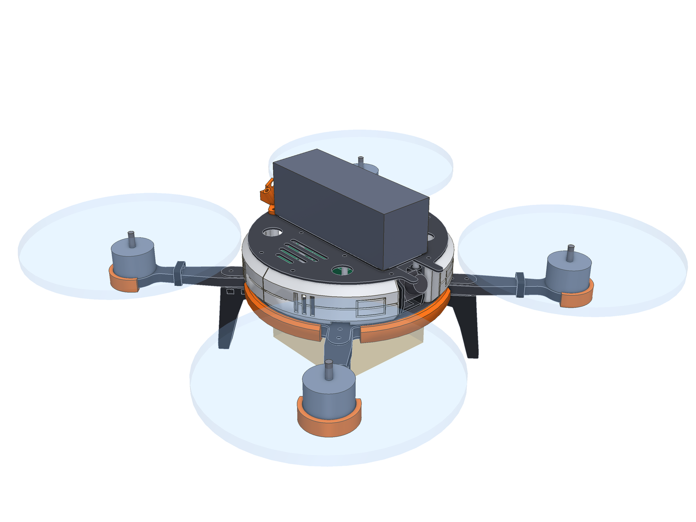
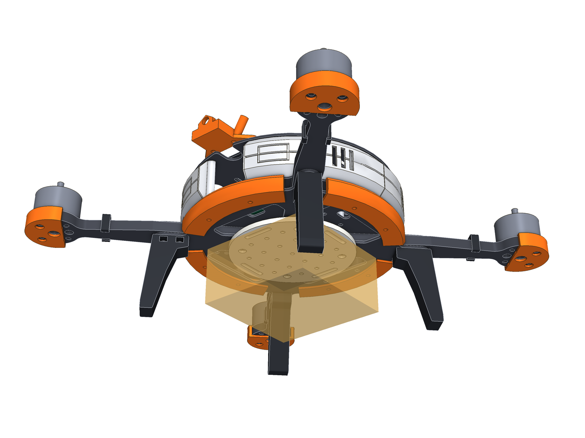
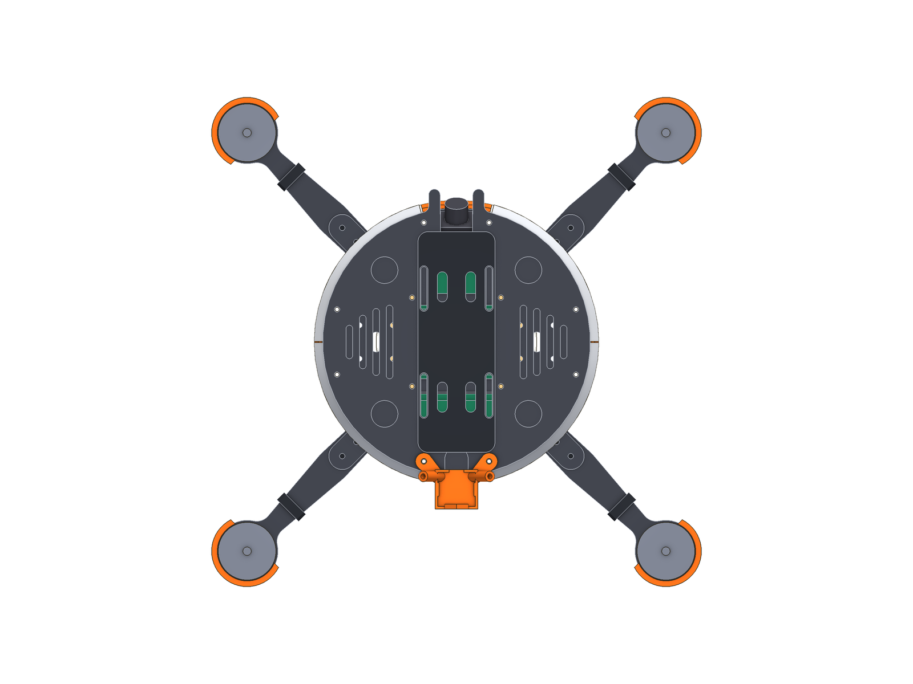
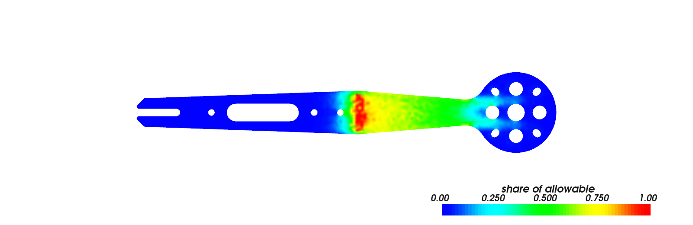

# Sfera 7" («Сфера»)

П'ята рама в цьому репозиторії: **вантажний 7-дюймовий квадрокоптер**. Круглий корпус-барабан,
вантаж під черевом у тій єдиній зоні, куди не дме жоден гвинт, високі ноги, бампер по всьому колу
і отвори під усе поширене — від стека 30,5 мм до Raspberry Pi Zero і Radxa Zero.



> **Стан.** CAD-модель. Геометрія перевірена автоматично (80 перевірок рами, 25 тестів), промінь
> порахований балковою моделлю і методом скінченних елементів, аеродинамічні числа — геометрією і теорією імпульсу.
> Нічого не вирізали, не друкували і не піднімали в повітря (див. «Що перевірено і що ні»).

Усі картинки — кожна деталь окремо і кожна на своєму місці — у [галереї](exports/GALLERY.md).
STL є для всього: карбону (`exports/cnc/`), друкованих деталей (`exports/print/stl/`) і збірок (`exports/assembly/`).

## Коротко

| | |
|---|---|
| Схема | **справжній X** (усі промені під 45°), база 354 мм, пропелери 7" |
| Корпус | диск Ø160 мм, бокові панелі роблять із нього «бочку» Ø170 мм; висота відсіків 35 мм |
| Вантаж | плита Ø96 мм під черевом: 21 вкладених гайок M3 на сітці 15 мм, прорізи під дві стяжки, серво-скидач |
| Ноги | 4 × 60 мм: вантаж до 90 × 90 × 45 мм приземляється на ноги, а не на себе |
| Промені | **8 мм**, 20 → 12 мм; база тримає перші 83 мм кожного |
| Стійки | **14 однакових** M3×35, вісім із них — по колу |
| Карбон | 5 різних деталей, **301 г** |
| Друк | 13 видів деталей: TPU ≈ 201 г, PETG (вантажна плита) ≈ 33 г |
| Комп'ютер | плата формату Zero 65 × 30 мм (Raspberry Pi Zero / Zero 2 W, Radxa Zero / Zero 3W / 3E) |
| Гвинти над карбоном | **4,9 %** робочої площі диска |

## 1. Що просили і що вийшло

| Вимога | Рішення |
|---|---|
| Круглі форми | Усі контури карбону — дуги й відрізки, база і верхня пластина — кола. Бокові панелі — тіла обертання навколо осі рами |
| Як на ескізі | Кругла база, X-промені, що заходять під коло; виріз під камеру спереду між двома стійками; «зябра» над боковими відсіками |
| Ідеально під вантаж | Справжній X: вантаж висить точно під центром тяги, рама однакова з усіх боків. Плита з гайками, стяжки, скидач, високі ноги |
| Усі аксесуари | Бокові панелі (4), бампер по колу (4 сегменти), ноги (4), захист моторів (4), вантажна плита, скидач, лоток комп'ютера, тримач GPS і антен, тримач камери (19 і 22 мм), килимок батареї, затискачі дротів |
| Багато отворів | Палуба: VTX 20×20, у кожному боковому відсіку 30,5×30,5 і 20×20, лоток комп'ютера. Верх: отвори під аксесуари, прорізи під ремінь. Плита: 21 гайок |
| SBC Radxa і Raspberry Pi Zero | Окремий задній відсік на всю ширину, плата лежить поперек на м'якому TPU-лотку |
| Футуристичний дизайн у дусі Star Wars | Світло-сірий корпус-барабан, один помаранчевий колір маркування, лінії панелей (паз по екватору, обрис люка), круглі порти у верхній пластині, «зябра». Форма і деталі — власні, це стиль, а не копія конкретного корабля |
| Аеродинаміка | Розділ 2 |

## 2. Аеродинаміка

Головне для вантажного квадрокоптера — не опір корпусу, а **що лежить під гвинтами**. Усе, що під диском,
гальмує потік, який мав дати тягу, і на це щосекунди йде енергія.

| Що | Число | Як отримано |
|---|---|---|
| Частка робочої площі диска над карбоном | **4,9 %** | площа променя і «пальця» бази під кільцем гвинта (без маточини Ø40) / площа кільця, `sfera/aero.py` |
| Зона, куди не дме жоден гвинт | коло **R 88,1 мм** | 177 мм (коло моторів) − 88,9 мм (радіус гвинта) |
| Зазор між кінцем лопаті і найширшим місцем корпусу | **3,1 мм** | R 88,1 − R 85,0 |
| Лобова площа | **103 см²** з будь-якого боку | база з бампером + бочка + батарея |
| Опір корпусу на 15 м/с | **1,1 Н** | Cd ≈ 0,8 (тупе тіло), оцінка |

Що з цього випливає в конструкції:

- **Вантаж — у зоні R 88 мм.** Ящик 90 × 90 мм, плита Ø96 мм, скидач — усе всередині. Вантаж не стоїть у струмені і не «з'їдає» тягу.
- **Ноги — тільки під променями.** Промінь уже затіняє цю смугу диска, тож нога додає майже нічого.
- **Дроти моторів — по променю**, затискачем до нього, і заходять у корпус через ворота в нижньому краї панелі.
- **Бочка замість барабана.** Панелі нахилені на 40° зверху і знизу: потік від гвинтів і зустрічне повітря обтікають ребро, а не б'ють у плоску стінку. Чесно: на швидкостях вантажника опір корпусу малий (1,1 Н на 15 м/с проти 4–6 Н тяги одного мотора на висінні) — бочка тут більше про жорсткість панелі і друк без підтримок, ніж про швидкість.

Потужність на висінні (теорія імпульсу, коефіцієнт якості гвинта 0,6, ККД мотора з регулятором 0,8):

| Злітна маса | Ідеальна | Очікувана електрична | Висіння на 6S 3300 мА·год (80 % ємності) |
|---|---|---|---|
| 1,5 кг | 114 Вт | 238 Вт | ≈ 15 хв |
| 2,0 кг | 176 Вт | 367 Вт | ≈ 10 хв |
| 2,5 кг | 246 Вт | 513 Вт | ≈ 7 хв |

Сама рама з електронікою і батареєю важить близько 1,5 кг (оцінка: карбон 301 г, стійки 20 г, друк 234 г, мотори й гвинти ~260 г, електроніка ~130 г, батарея ~520 г), тож рядки — це без вантажу, +0,5 кг і +1 кг. Це порівняльна оцінка, не обіцянка: реальне число залежить від гвинта, мотора і вітру.

## 3. Вантаж



**Плита** (PETG, Ø96 × 4 мм) прикручується знизу чотирма болтами в стійки стека — ті самі отвори, що тримають
промені. Гайки M3 вкладаються в гнізда до того, як плита стане на місце, і тримаються між плитою та базою.

- **Сітка 15 мм** — для кронштейнів, коробок, тримачів.
- **Квадрат 30,5 мм у центрі** — туди стає все, що зроблене під кріплення стека: друга камера, лідар, LED-модуль.
- **Чотири прорізи** — під дві стяжки навхрест для м'якого вантажу.

**Скидач** (окремий варіант, у збірці не показаний) — дві щоки на сталевому штифті 3 мм. Кільце вантажу
висить між щоками на штифті, 9-грамове серво висмикує штифт. Вантаж тримають щоки, серво лише рухає штифт,
тому вистачає маленького. Хід серво (±35°) висуває штифт на 12,6 мм; щоб відпустити, треба 8,0 мм.

**Ноги** 60 мм, TPU, кожна на двох зовнішніх болтах променя. Ящик 90 × 90 × 45 мм під плитою лишається
на 9 мм вище землі.

Скільки можна везти, **не пораховано**: ні міцність PETG-плити, ні тяга моторів у цій моделі не перевірялись.
Якщо прийняти типові ~1,5 кг максимальної тяги на мотор 2807 із 7" гвинтом на 6S (звірте з таблицею вашого мотора)
і запас тяги 2:1, злітна маса виходить до ~3 кг, тобто вантаж близько 1–1,5 кг. Починайте з 300–500 г.

## 4. Компонування



Початок координат — центр стека, +Y — ніс.

| Відсік | Де | Що в ньому |
|---|---|---|
| Носовий | між камерними стійками і носовою парою | FPV-камера 19 або 22 мм (нахил 15–45°), за нею VTX 20×20 |
| Бокові (2) | під «зябрами» | на кожному отвори 30,5×30,5 і 20×20: VTX 30,5, приймач, BEC, датчики (GPS — тільки зверху: карбон глушить сигнал) |
| Центральний | стек 30,5×30,5 | SpeedyBee F405 + 4-в-1 ESC |
| Задній | на всю ширину | комп'ютер формату Zero на TPU-лотку, над ним 25 мм вільного місця |
| Зверху | уздовж | батарея 6S до 46 × 132 мм; ззаду тримач GPS і антен |
| Під черевом | коло R 88 | вантаж |

Висоти (Z = 0 — низ нижньої обшивки): ноги −60, вантажна плита −6…−2, база 0…11,5, відсіки 11,5…46,5,
лопаті 28…44, верхня пластина 46,5…48,5.

## 5. Розрахунок променя

Промінь — той самий переріз, що вже порахований для [Zvir](../Zvir-7inch) (8 мм, 20 → 12 мм): на 7-дюймовому
мотор-гвинті 62 г 6-мм промінь резонував би на середньому газі. Тут база тримає промінь пальцем до 83 мм,
тому вільна довжина — 72,4 мм.

| | Балкова модель | FEA (3D, ортотропний карбон) |
|---|---|---|
| Вертикальна сила до 600 МПа | 1767 Н | **1612 Н** |
| Бічна сила до 600 МПа | 4247 Н | **4050 Н** |
| Жорсткість вертикальна | 356 Н/мм | **286 Н/мм** |
| Перша власна частота (мотор 62 г) | 380 Гц | **307 Гц** (≈ 18 400 об/хв) |
| Маса променя | | 37,4 г |



- Балкова модель завищує частоту приблизно на 15 %: вона не бачить податливості затиску. Абсолютні числа беріть із FEA.
- 600 МПа — обережна межа для тканини 0/90 **уздовж волокон**. Промені різати вздовж волокон.
- Тяга мотора на висінні — 4–6 Н, максимальна — близько 15 Н. Розмір променя визначає частота, а не міцність.

## 6. Що замовляти

### Карбон

| Деталь | Товщина | Кількість | Файл |
|---|---|---|---|
| Нижня обшивка | 2 мм | 1 | `cnc/plate_bottom_2mm.dxf` |
| Палуба | 1,5 мм | 1 | `cnc/plate_mid_1.5mm.dxf` |
| Верхня пластина | 2 мм | 1 | `cnc/plate_top_2mm.dxf` |
| Промінь | **8 мм** | 4 | `cnc/arm_8mm_x4.dxf` |
| Шайба-вставка під стійку | 8 мм | 10 | `cnc/puck_8mm_x10.dxf` (або 10 дистанційних втулок M3 × 8 мм) |

Найвужча перемичка 2,96 мм, найменший радіус 1 мм (фреза 2 мм).

### Метизи

| Що | Скільки | Куди |
|---|---|---|
| Стійка M3×35, кругла, Ø5 | 14 | усі на палубі |
| M3×35 + гайка | 4 | болти стека крізь базу 11,5 мм |
| M3×22, напівкругла головка | 4 | внутрішні болти променів крізь вантажну плиту (M3×16 без плити) |
| M3×18 | 8 | стійки по колу, крізь бампер |
| M3×16 | 2 | камерні стійки |
| M3×20 + самоконтрна гайка | 8 | два зовнішні болти кожного променя, гайка в нозі |
| M3×8 | 14 | верхня пластина |
| M3×12 | 16 | мотори: промінь 8 мм — **звірте з глибиною різьби мотора** |
| Гайка M3 | 21 | вантажна плита |
| M3×6 + гайка | 2 | лоток комп'ютера |
| M2,5×6 самонарізні | 4 | плата комп'ютера |

Розраховано під мотори 2806.5 / 2807 (19 × 19 мм), 7" гвинти, стек 30,5 мм, батарею 6S до 46 × 132 × 46 мм.

## 7. Друк

| Деталь | Матеріал | Кількість | Маса, г (одна) | Розмір на столі, мм |
|---|---|---|---|---|
| `hull_a` — Hull panel A (front right, rear left) | TPU 95A | 2 | 12,2 | 70 × 82 × 35 |
| `hull_b` — Hull panel B (front left, rear right) | TPU 95A | 2 | 12,2 | 70 × 82 × 35 |
| `bumper` — Rim bumper | TPU 95A | 4 | 9,1 | 96 × 29 × 13 |
| `leg` — Landing leg | TPU 95A | 4 | 18,1 | 44 × 64 × 16 |
| `cargo_plate` — Cargo plate | PETG | 1 | 33,1 | 96 × 96 × 6 |
| `cargo_hook` — Cargo release (servo hook) *(варіант)* | PETG | 1 | 14,1 | 57 × 39 × 29 |
| `sbc_tray` — Companion-computer tray (Zero size) | TPU 95A | 1 | 3,6 | 67 × 32 × 5 |
| `camera_mount_19` — Camera mount, micro 19 mm | TPU 95A | 1 | 5,7 | 40 × 18 × 27 |
| `camera_mount_22` — Camera mount, mini 22 mm *(варіант)* | TPU 95A | 1 | 5,1 | 40 × 18 × 27 |
| `perch` — Perch (GPS tray and antenna holder) | TPU 95A | 1 | 4,1 | 49 × 34 × 19 |
| `arm_guard` — Arm guard | TPU 95A | 4 | 4,3 | 40 × 40 × 11 |
| `battery_pad` — Battery pad | TPU 95A | 1 | 10,1 | 46 × 132 × 3 |
| `wire_clip` — Motor-wire clip | TPU 95A | 4 | 0,7 | 22 × 22 × 6 |

TPU 95A, сопло 0,4 мм. Вантажна плита і скидач — PETG або ASA, 4 периметри, 40 % заповнення.
Кожна деталь лягає на стіл пласкою гранню і друкується без підтримок — це перевіряється в коді.
Бокові панелі друкуються стоячи, як стоять на палубі: 40° нахилу — межа, яку принтер бере без підтримок.

## 8. Код

Рама працює на рушії [Zhalo](../Zhalo-5inch) зі своїми розмірами (`src/sfera/sizing.py`), профілями
(`profiles.py`), корисним навантаженням (`payload.py`), аеродинамічними оцінками (`aero.py`) і друкованими
деталями (`accessories/`).

```bash
cd Sfera-7inch
uv sync
uv run sfera check          # усі геометричні перевірки
uv run sfera analyse        # балкова модель + FEA (потрібна libGLU: apt install libglu1-mesa)
uv run python -m sfera.aero # аеродинамічні числа
uv run sfera all            # exports/: DXF, STEP, STL, 3MF, FreeCAD, рендери, галерея
uv run pytest
```

## Що перевірено і що ні

**Перевірено кодом:** кожна деталь — одне суцільне тіло; нічого не перетинається; кожен болт проходить усі шари;
стійки стоять на карбоні; корпус і друковані деталі поза дисками гвинтів із запасом 2,5 мм; жоден гвинт не над
корпусом і не над вантажем; обидві FPV-камери проходять свій нахил; вантаж 90 × 90 × 45 мм вище ніг; хід серво
скидача висмикує штифт; перемички карбону ≥ 2 мм; друк без підтримок і без стінок тонших за 0,9 мм.

**Не перевірено:**

- Нічого не виготовлено. Посадки TPU (кільця на стійках, гайки в ногах) взяті з правил, що працюють для TPU 95A.
- Вантажопідйомність: ні міцність PETG-плити, ні тяга моторів не рахувались. Число в розділі 3 — оцінка з типових даних.
- Аеродинаміка — геометрія і теорія імпульсу, без CFD і без продувки. Добре порівнює варіанти, абсолютні числа приблизні.
- Розміри серво SG90 і плат формату Zero взяті з типових креслень — зміряйте свої.
- FEA рахує один промінь, жорстко затиснутий у базі; реальний затиск м'якший, частота буде трохи нижчою.
- Ноги перевірені тільки на висоту і положення; жорстку посадку з вантажем на них ніхто не моделював.
