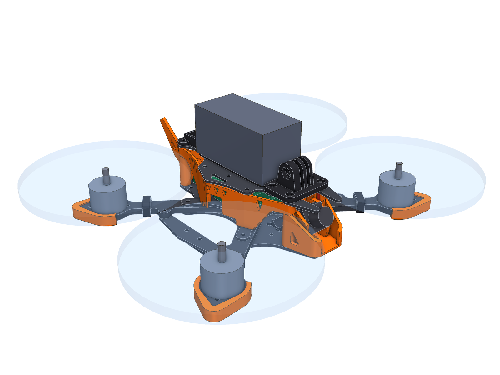
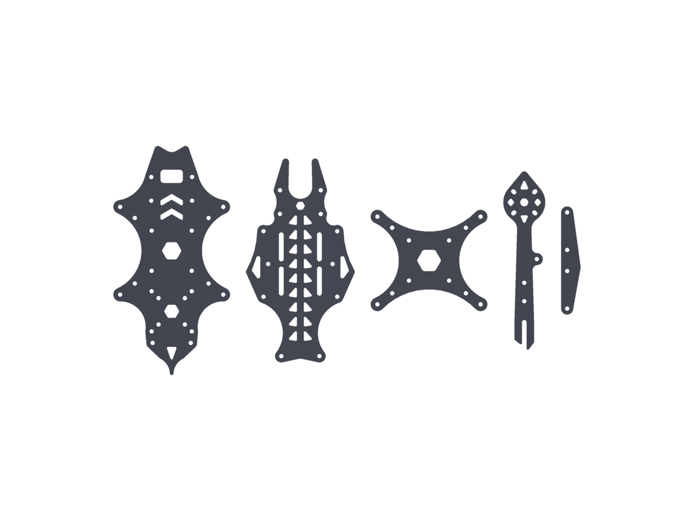
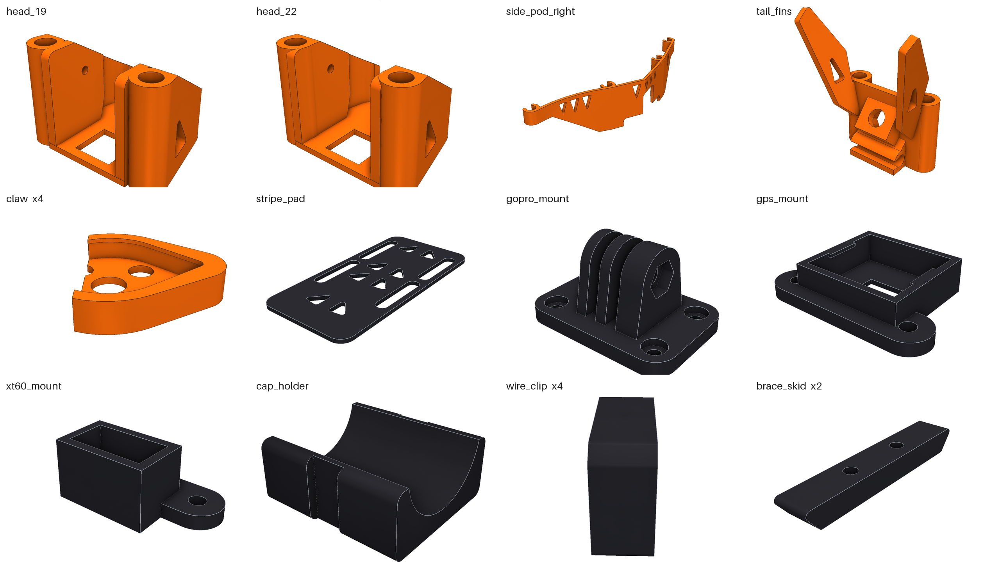
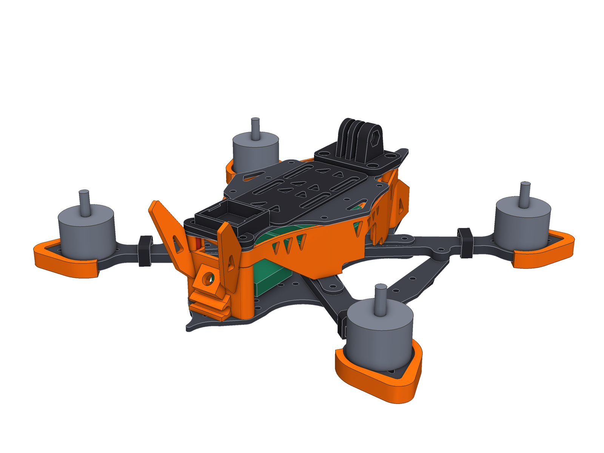
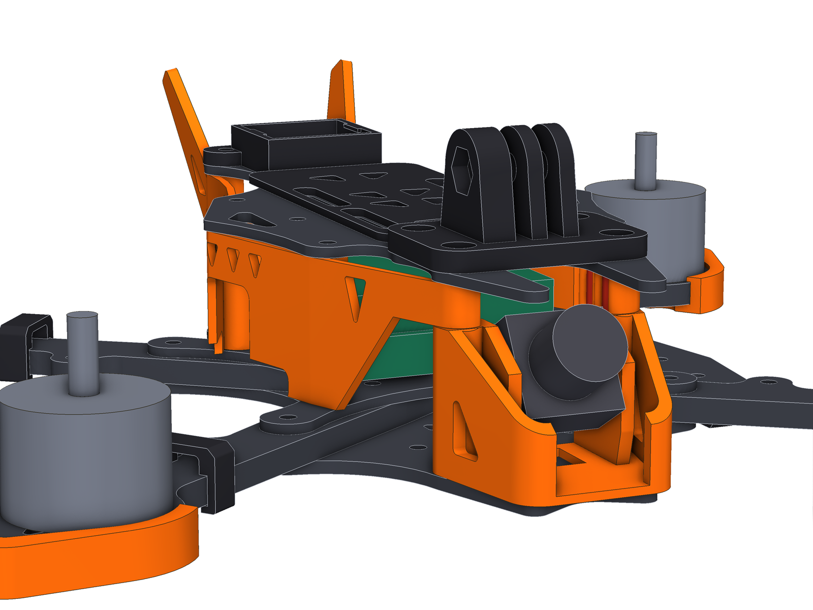

# Shershen 5" («Шершень»)

Стильна версія рами [Zhalo](../Zhalo-5inch): ті самі точки кріплення і та сама електроніка
(**SpeedyBee F405**, **аналоговий VTX**, камера 19/22 мм), але інший вигляд усього, що видно —
і карбону, і TPU.



> **Стан.** CAD-модель, перевірена розрахунками. Не вирізана і не облітана. Перед замовленням карбону
> надрукуй пластини з PLA для примірки.

## Чим відрізняється від Zhalo

| | Zhalo | Shershen |
|---|---|---|
| Верхня пластина | рівний хвилястий контур, шеврони | **стрілоподібні крила**, осина талія, «риб'яча кістка» вздовж суцільного хребта |
| Нижня пластина | тупий ніс, просте жало | **роздвоєний ніс** (ікла), **жало із зазубринами**, шестикутні вікна |
| Промінь | круглий майданчик мотора | **загострений кінець**, трикутні вікна вздовж осі |
| Розпірка | рівна планка | планка з **крильцем** назовні |
| TPU | один колір | **два кольори**: акцентні деталі + чорні службові |
| Перед | кріплення камери + окремий бампер | **«щелепи»**: кріплення камери і бампер одним шматком |
| Боки | пласкі панелі зі стільниками | **V-подібні обтічники** під крилами, ряд «зубів» |
| Хвіст | кріплення антен | те саме кріплення + **два розвалені кілі** |
| Кінці променів | круглий захист | **«кігті»** з потовщенням на вістрі |
| Карбон | 116 г | 123 г |

Спільне: wide-X 225 мм, пропелери до 5.1", стійки 4 × M3×28 + 4 × M3×35, усі отвори, уся висотна
схема, список метизів і порядок складання — див. [README Zhalo](../Zhalo-5inch/README.md).

## Карбон



Файли в [`exports/cnc/`](exports/cnc): DXF (мм, лише дуги і відрізки) і STEP.

| Деталь | К-сть | Товщина | Габарит, мм | Маса, г |
|---|---|---|---|---|
| `plate_bottom_2.5mm` | 1 | 2.5 | 89 × 174 | 29.6 |
| `plate_top_2mm` | 1 | 2.0 | 83 × 155 | 18.4 |
| `plate_mid_2mm` | 1 | 2.0 | 89 × 77 | 9.1 |
| `arm_5mm_x4` | 4 | 5.0 | 136 × 32 | 15.1 |
| `brace_2mm_x2` | 2 | 2.0 | 15 × 82 | 2.8 |

Внутрішні радіуси ≥ 1 мм (фреза 2 мм), перемички ≥ 2.3 мм.

Чому «риб'яча кістка», а не шеврони: посередині пластини по всій довжині лишається суцільна смуга
карбону 5 мм (у шевронів її немає). Задум — жорсткість під батареєю; сама жорсткість не рахувалась.

Крила не декоративні: під ними ховаються бічні обтічники, і вони стоять у зоні між передніми та
задніми пропелерами, куди лопаті не дістають (перевірено з запасом 2.5 мм).

## TPU



Файли в [`exports/print/`](exports/print), уже в положенні для друку. Підтримки не потрібні.

**Акцентний колір** (помаранчевий на рендерах — друкуй будь-яким яскравим):

| Деталь | К-сть | Маса, г | Що це |
|---|---|---|---|
| `head_19` / `head_22` | 1 | 9.0 | кріплення камери + бампер носа: «щелепи» обходять ніс і не доходять до середини, лишаючи проріз для об'єктива |
| `side_pod_left/right` | по 1 | 6.4 | бічний обтічник, у плані — літера V під крилом; защіпається на 4 стійки ззовні |
| `tail_fins` | 1 | 7.9 | кріплення SMA (40°) і T-антени з двома кілями по боках антени |
| `claw` | 4 | 3.9 | захист кінця променя, 4.6 мм TPU на вістрі |

**Чорний TPU**:

| Деталь | К-сть | Маса, г | |
|---|---|---|---|
| `stripe_pad` | 1 | 4.5 | підкладка батареї з тією ж «кісткою»; 4 штифти у вікна пластини |
| `gopro_mount` | 1 | 9.1 | як у Zhalo |
| `gps_mount` **або** `xt60_mount` | 1 | 2.7 / 2.5 | як у Zhalo |
| `cap_holder`, `wire_clip` ×4, `brace_skid` ×2 | | 0.7 / 0.5 / 2.4 | як у Zhalo |

Повний комплект ≈ 69 г. Налаштування друку — ті самі, що для Zhalo (TPU 95A, сопло 0.4, 4 периметри).





### Навіщо кілі

Чесно: це передусім стиль. Практична користь скромна — вони прикривають з боків основу антени і
SMA-роз'єм. Зроблені з TPU, тож в аварії складаються і повертаються, а не ламаються.

## Звідки стиль

Перед малюванням я подивився фото кількох рам, які вважають гарними, і взяв повторювані прийоми:

- акцентний колір TPU проти чорного карбону — [GEPRC Mark5](https://geprc.com/product/geprc-gep-mk5-frame/);
- загострені кінці променів із вікнами і плавні «крила» в контурі пластин —
  [Axisflying Manta 5 SE](https://oscarliang.com/axisflying-manta-5-se-frame);
- довгі гранчасті накладки на кінцях променів —
  [FlyFishRC Volador VX5](https://www.flyfish-rc.com/products/volador-ii-vx5-o3-fpv-freestyle-t700-frame-kit);
- бічні панелі як частина силуету —
  [iFlight Nazgul Evoque F5 V2](https://www.racedayquads.com/products/iflight-nazgul-evoque-f5x-v2-5-frame-kit-w-led-side-plates).

Геометрія при цьому власна: жоден контур не скопійований.

## Як це влаштовано в коді

Shershen не дублює рушій. Пакет `shershen` імпортує `zhalo` і підміняє в ньому дві речі:

- `frame.SHEETS` — п'ять карбонових профілів ([`profiles.py`](src/shershen/profiles.py));
- `accessories.MODULES` — список друкованих деталей.

Параметри, електроніка, усі перевірки, експорт і рендер — спільні. Тому кожна перевірка Zhalo
автоматично виконується і для цієї рами.

```sh
uv sync
uv run shershen check        # усі перевірки
uv run shershen export       # exports/
uv run shershen render       # exports/renders/
uv run pytest -q
```

## Що перевірено і що ні

Те саме, що для Zhalo: 56 перевірок рами (болти, диски пропелерів, електроніка, перемички, радіуси)
плюс кожен аксесуар окремо і всі разом — усе проходить.

Не перевірено: міцність (зокрема тонших кілів і крил при аварії), посадки TPU на твоєму принтері,
положення USB на конкретній ревізії польотного контролера.
