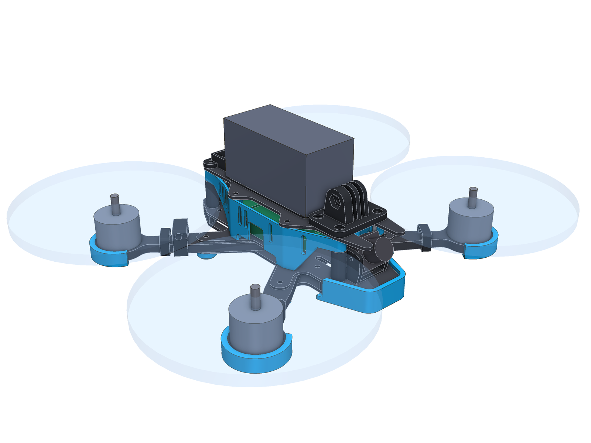
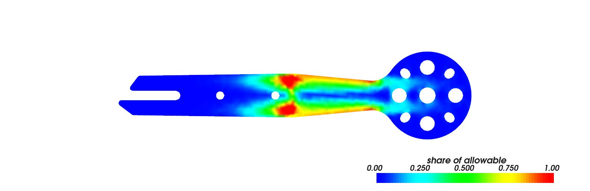
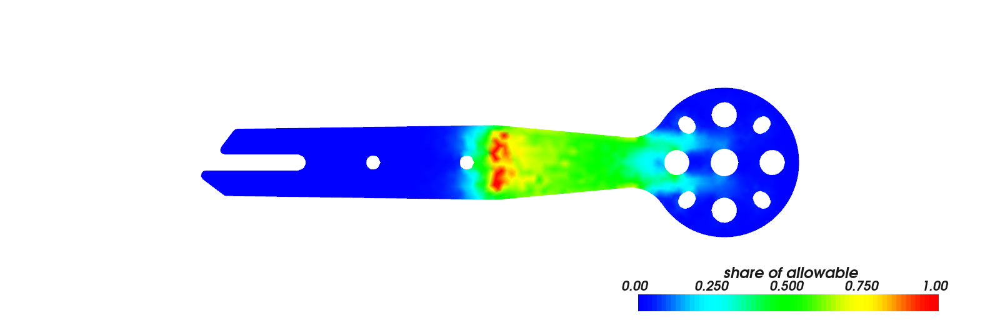
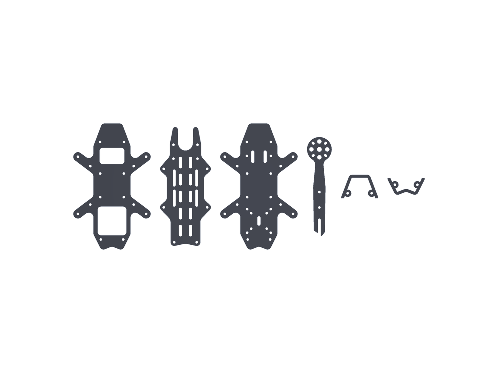
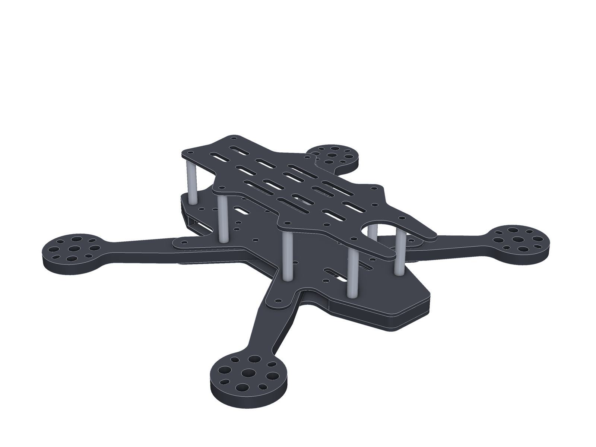
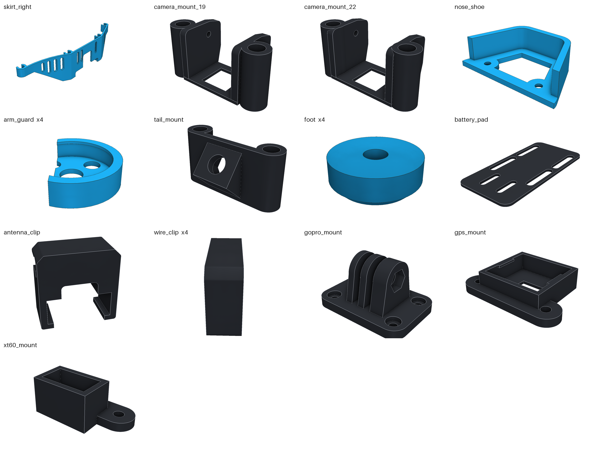
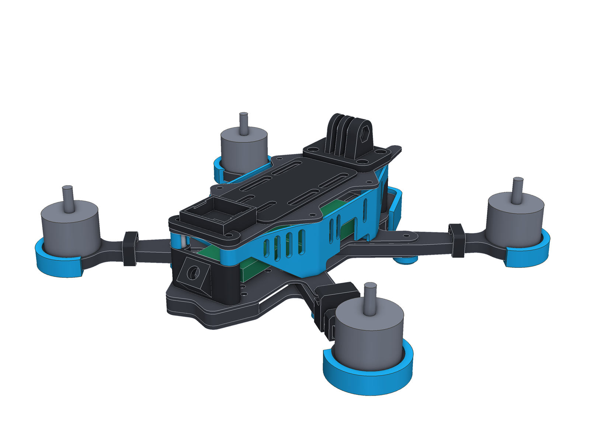

# Strila 5" («Стріла»)

Третя рама в цьому репозиторії. Не «жук»: прямі лінії, один радіус скруглення, один мотив вирізів.
Розміри променів і підлоги взяті не «як у всіх», а з розрахунку.

Електроніка та сама, що в [Zhalo](../Zhalo-5inch): стек **SpeedyBee F405**, **аналоговий VTX**, камера 19 або 22 мм.



> **Стан.** CAD-модель. Геометрія перевірена, промінь порахований балковою моделлю і методом скінченних
> елементів. Раму не вирізали і не ламали на стенді — числа міцності порівняльні, а не паспортні
> (див. «Що це означає і чого не означає»).

Усі картинки — кожна деталь окремо і кожна на своєму місці — зібрані в [галереї](exports/GALLERY.md). STL є для всього: карбону (`exports/cnc/`), друкованих деталей (`exports/print/stl/`) і збірок (`exports/assembly/`).

## Коротко

| | |
|---|---|
| Схема | wide-X, база 225 мм, пропелери до 5.1" |
| Промені | **6 мм**, найширші (16 мм) там, де виходять із сендвіча, 10.5 мм біля мотора |
| Підлога | **дві тонкі обшивки** (2 + 1.5 мм) з променями між ними, замість однієї товстої пластини |
| Стійки | **8 однакових** M3×28, усі стоять на одному рівні |
| Карбон | 6 різних деталей, 135 г |
| TPU | 13 видів деталей, повний комплект ≈ 62 г |
| Проти променя Zhalo | вертикальне навантаження **+77 %**, бічне **+85 %**, перша власна частота **251 → 396 Гц**, +3 г на промінь |

## 1. Дослідження

Що я з'ясував перед тим, як малювати.

| Питання | Що знайшов | Що з цього взяв |
|---|---|---|
| Як зроблений Nazgul Evoque F5 V2 | Промені 6 мм, нижня пластина 3 мм, база 225 мм, довгий вузький корпус із бічними панелями | 6 мм промені, вузький прямий корпус, бічні панелі |
| Що ламається першим | Промені. Тренд — вужчі, але товщі: менша вага і вищий резонанс рами | Товщина 6 мм замість ширини |
| Як кріпити промені | Затиснуті між двома пластинами жорсткіші за суцільну «unibody» і гасять вібрації тертям | Сендвіч, і не лише в центрі, а на всю довжину |
| Де концентруються напруження | На гострих кутах; округлі вирізи кращі | Жодного гострого кута, у вільній частині променя немає вирізів |
| Який карбон | Тканина 0/90: уздовж волокон модуль ≈ 60 ГПа, міцність на згин 600–880 МПа; під 45° — у рази менше | У розрахунку 60 ГПа і обережні 600 МПа; **промені різати вздовж волокон** |

Джерела: [iFlight Nazgul Evoque F5 V2](https://www.racedayquads.com/products/iflight-nazgul-evoque-f5x-v2-5-frame-kit-w-led-side-plates),
[характеристики на сайті iFlight](https://iflight-rc.eu/en/products/nazgul-evoque-f5-v2-frame-kit),
[посібник Oscar Liang про рами](https://oscarliang.com/fpv-drone-frames/),
[дані Toray T300](https://www.toraycma.com/wp-content/uploads/T300-Technical-Data-Sheet-1.pdf),
[лист даних 3K twill](https://customisedcomposites.squarespace.com/s/Technical-data-sheet-Veneer.pdf).

## 2. Розрахунок

### Модель в одному абзаці

Промінь — консоль від краю сендвіча до мотора. Два випадки навантаження на кінці:
**вертикальне** (тяга, жорстка посадка, удар зверху чи знизу) і **бічне** у площині рами (влетів променем
у гілку чи ворота). Для кожного рахується найбільше напруження, жорсткість, власна частота з мотором на
кінці і **енергія, яку промінь приймає до руйнування**. Аварія — це енергія, а не сила, тому саме
останнє число каже, наскільки сильний удар промінь переживе.

### Крок 1. Балкова модель: який переріз брати

Порівняння з променем Zhalo (5 мм, 13 → 11 мм). Вільна частина променя, без майданчика мотора:

| Варіант | Маса | Сила до руйнування, верт. / бічна | Жорсткість | Частота |
|---|---|---|---|---|
| 5 мм, лише довші «ноги» сендвіча | −16 % | +9 % / +6 % | +39 % | +18 % |
| 6 мм, 12 → 10 мм | −4 % | +49 % / +15 % | +127 % | +51 % |
| 6 мм, 14 → 9.5 мм | +2 % | +74 % / +56 % | +149 % | +58 % |
| 6 мм, 16 → 9 мм | +14 % | +99 % / +104 % | +181 % | +68 % |

Три висновки:

1. **Товщина дає більше, ніж ширина.** При тій самій масі 6 мм проти 5 мм — у півтора раза міцніше
   вертикально і більш ніж удвічі жорсткіше.
2. **Конус дає більше, ніж рівна планка.** Згинальний момент спадає від сендвіча до мотора; матеріал,
   який стоїть там, де моменту мало, — мертва вага.
3. **Довші «ноги» сендвіча майже безкоштовні.** Зовнішній болт променя перенесено з 30 на 36 мм:
   вільна довжина 55.9 → 49.1 мм, усі напруження менші на десяту.

### Крок 2. Скінченні елементи: перевірка на реальній формі

Реальний 3D-промінь, квадратичні тетраедри з розміром 1.6 мм, ортотропний матеріал (волокна вздовж і
впоперек променя). Частина під пластинами затиснута з обох боків, сила прикладена до стінок чотирьох
отворів під гвинти мотора.

МСЕ знайшов те, що балкова модель пропустила: при бічному ударі слабким місцем була **не основа, а шийка
9 мм перед мотором**: 0.25 МПа на ньютон за МСЕ, тоді як біля сендвіча за балковою оцінкою 0.19.
Шийку розширено до 10.5 мм — тепер найнавантаженіше місце змістилось у середину вільної частини:



*Бічне навантаження на межі руйнування: частка від допустимого напруження. Обидві кромки завантажені
рівномірно від сендвіча до шийки — матеріал працює весь.*



*Вертикальне навантаження: пік на краю сендвіча, саме там промінь найширший.*

### Результат

Обидва промені пораховані тим самим кодом на тій самій сітці:

| | Zhalo | **Strila** | Зміна |
|---|---|---|---|
| Маса променя | 14.6 г | 17.6 г | +21 % |
| Вертикальне навантаження до руйнування | 597 Н | **1056 Н** | +77 % |
| Бічне навантаження до руйнування | 1514 Н | **2806 Н** | +85 % |
| Вертикальна жорсткість | 119 Н/мм | **305 Н/мм** | +156 % |
| Бічна жорсткість | 580 Н/мм | **1182 Н/мм** | +104 % |
| Перша власна частота | 251 Гц | **396 Гц** | +58 % |
| Енергія до руйнування, вертикально | 1.50 Дж | 1.83 Дж | +22 % |
| Енергія до руйнування, збоку | 1.98 Дж | 3.33 Дж | +69 % |

Сирі числа — в [`exports/analysis/analysis.json`](exports/analysis/analysis.json).

### Що це означає і чого не означає

- **Відносні числа надійні.** «На 77 % міцніший за промінь Zhalo» — це порівняння двох форм одним
  методом на одній сітці.
- **Абсолютні — ні.** 1056 Н отримано для допустимого напруження 600 МПа. Реальна плита може мати
  і 450, і 850 МПа: залежить від волокна, смоли, викладки. Жодних випробувань не було.
- **Піки на краю затиску** — особливість ідеально жорсткого затиску в моделі. Тому напруження взято
  як рівень, який перевищує лише 0.5 % об'єму.
- **Пораховано лише промінь.** Пластини, болтові з'єднання, втома і розшарування не рахувались.
- **Напрям волокон критичний.** Промінь, вирізаний під 45° до тканини, буде в рази слабший за ці числа.

## 3. Як влаштована рама



Зліва направо: нижня обшивка, верхня пластина, палуба (верхня обшивка), промінь, носове і хвостове ядро.

### Сендвіч-підлога

Замість однієї пластини 3 мм — дві тонкі (2 мм знизу, 1.5 мм зверху), рознесені на 6 мм. Між ними:

- у центрі — корені чотирьох променів;
- у носі та хвості — **ядра**: рамки 6 мм, вирізані з того ж листа, що й промені.

Усе стягнуто наскрізними болтами. Навіщо:

- **Жорсткість.** Момент інерції двох рознесених обшивок (разом 3.5 мм карбону) приблизно у 20 разів
  більший, ніж в однієї пластини 3 мм. Це розрахункова верхня межа: болтове з'єднання дає лише
  частину, бо обшивки трохи ковзають одна відносно одної. Скільки саме — не міряно.
- **Ніс.** Передній край — не дві тонкі кромки, а суцільна плита 9.5 мм: дві обшивки і ядро між ними.
- **Рівна палуба.** Стек, VTX і камера стоять на одному рівні, усі вісім стійок однакові.

Нижня обшивка відкрита під обома відсіками: менша вага, і до гвинтів VTX є доступ знизу.

### Промінь



- Форма — «спис»: розширюється до краю сендвіча (16 мм), далі прямий конус до шийки 10.5 мм.
- У вільній частині немає жодного отвору чи вирізу.
- Обидва болти і паз під болт стеку лежать на осі променя: при бічному згині це нейтральна лінія,
  отвори там майже не послаблюють переріз.
- Як у Zhalo: промінь знімається без розбирання стеку (відкритий паз), корені впираються один в одного.
- Чотири отвори Ø5.5 під основою мотора знімають близько грама з кожного променя там, де карбон
  майже не навантажений.

### Висоти

| Шар | Z, мм |
|---|---|
| Нижня обшивка | 0 – 2 |
| Промені та ядра | 2 – 8 |
| Палуба | 8 – 9.5 |
| Стійки (28 мм) | 9.5 – 37.5 |
| Верхня пластина | 37.5 – 39.5 |

## 4. Що замовляти

### Карбон

Файли в [`exports/cnc/`](exports/cnc): DXF (мм, лише дуги і відрізки), STEP і STL.

| Деталь | К-сть | Товщина | Габарит, мм | Маса, г |
|---|---|---|---|---|
| `plate_bottom_2mm` | 1 | 2.0 | 100 × 163 | 20.7 |
| `plate_mid_1.5mm` (палуба) | 1 | 1.5 | 100 × 163 | 19.6 |
| `plate_top_2mm` | 1 | 2.0 | 66 × 154 | 17.2 |
| `arm_6mm_x4` | 4 | 6.0 | 128 × 32 | 17.6 |
| `core_nose_6mm` | 1 | 6.0 | 48 × 31 | 4.0 |
| `core_tail_6mm` | 1 | 6.0 | 48 × 22 | 3.4 |

**Скажи виконавцю: промені розкладати вздовж волокон тканини.** Внутрішні радіуси ≥ 1 мм, перемички ≥ 2.5 мм.

### Метизи

| Що | К-сть | Куди |
|---|---|---|
| Стійка M3×28, Ø5 | 8 | усі на палубі |
| M3×30 + гайка (зі стеку) | 4 | болти стеку крізь підлогу 9.5 мм |
| M3×16 | 8 | внутрішні болти променів (4) і болти носа та хвоста (4): знизу крізь підлогу в стійки |
| M3×14 + самоконтрна гайка | 4 | зовнішні болти променів (M3×16, якщо ставиш ніжки) |
| M3×8 | 8 | верхня пластина |
| **M3×10** | 16 | мотори. Промінь 6 мм: M3×8 дає лише 2 мм різьби. **Перевір глибину різьби свого мотора** |

## 5. TPU



Файли в [`exports/print/`](exports/print), уже в положенні для друку, без підтримок.

| Деталь | К-сть | Що це |
|---|---|---|
| `skirt_left/right` | по 1 | бічні панелі з вертикальними «зябрами»; защіпаються на 4 стійки ззовні |
| `camera_mount_19` / `_22` | 1 | кріплення камери на передніх стійках, нахил 15–45° |
| `nose_shoe` | 1 | бампер носа: дно і стінка навколо краю підлоги, на двох передніх болтах |
| `arm_guard` | 4 | захист кінця променя; гвинти мотора спираються на карбон, не на TPU |
| `tail_mount` | 1 | SMA антени VTX під 40° |
| `antenna_clip` | 1 | T-антена приймача на задньому правому промені, подалі від антени VTX |
| `foot` | 4 | ніжки під кінцями «ніг» сендвіча: найнижчі точки, коптер стоїть рівно |
| `battery_pad` | 1 | підкладка батареї, 4 штифти у вирізи верхньої пластини |
| `wire_clip` | 4 | кліпси проводів мотора |
| `gopro_mount` | 1 | кріплення екшн-камери |
| `gps_mount` **або** `xt60_mount` | 1 | лоток GPS чи тримач XT60: ставиться одне з двох |

Друк: TPU 95A, сопло 0.4, шар 0.2, 4 периметри. Бічні панелі друкуються верхнім краєм донизу.



## 6. Код

Strila працює на рушії Zhalo, але зі своїми розмірами: пакет `strila` викликає `params.configure()`
і підставляє свої профілі та список деталей. Тому всі 59 геометричних перевірок рушія діють і тут.

```sh
uv sync
uv run strila check        # геометрія: болти, пропелери, електроніка, перемички, друк
uv run strila analyse      # розрахунок променя: балкова модель + МСЕ
uv run strila export       # exports/
uv run strila render       # exports/renders/
uv run pytest -q
```

Для МСЕ потрібні `gmsh` і `scikit-fem` (ставляться з `uv sync`) та системна бібліотека `libGLU`
(`apt install libglu1-mesa`). Без них `analyse` порахує лише балкову модель.

Хочеш інший переріз — зміни числа в [`src/strila/sizing.py`](src/strila/sizing.py) і запусти `analyse`.

## Що перевірено і що ні

**Перевірено:** жодні деталі не перетинаються; кожен болт проходить усі шари; корпус і аксесуари ≥ 2.5 мм
поза дисками пропелерів; стек, VTX обох розмірів, камери 19 і 22 мм на всьому діапазоні нахилу та
батарея вміщаються; кожна друкована деталь лягає на стіл і друкується без підтримок.

**Не перевірено:** усе з розділу «Що це означає і чого не означає»; посадки TPU на твоєму принтері;
положення USB на конкретній ревізії польотного контролера (`GATE_Y` у бічній панелі).
