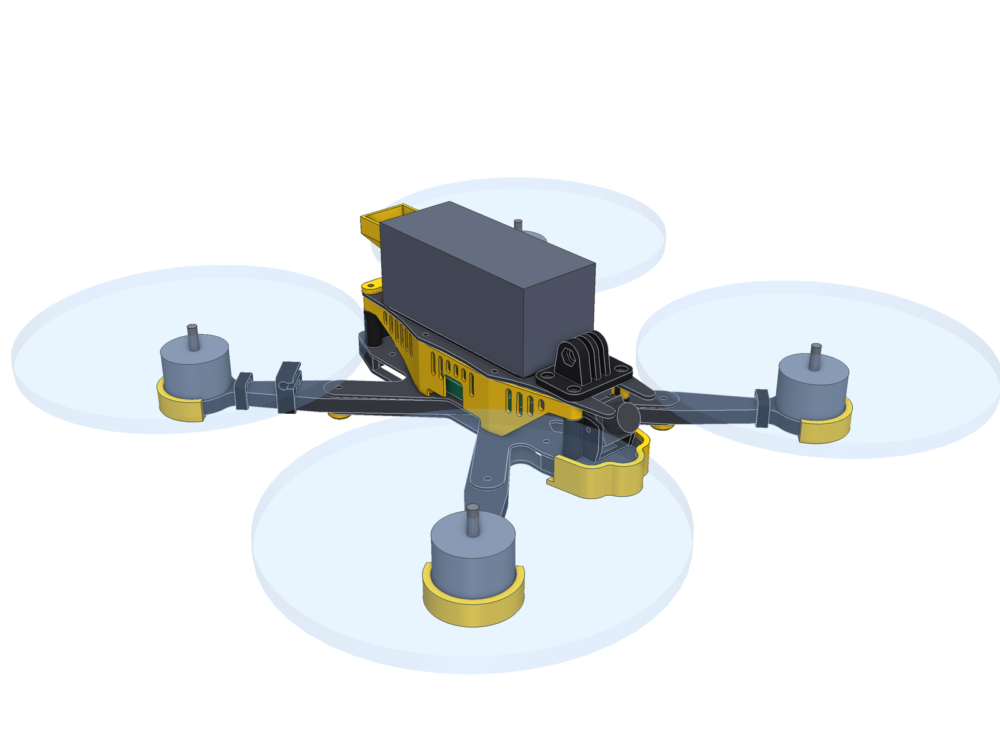
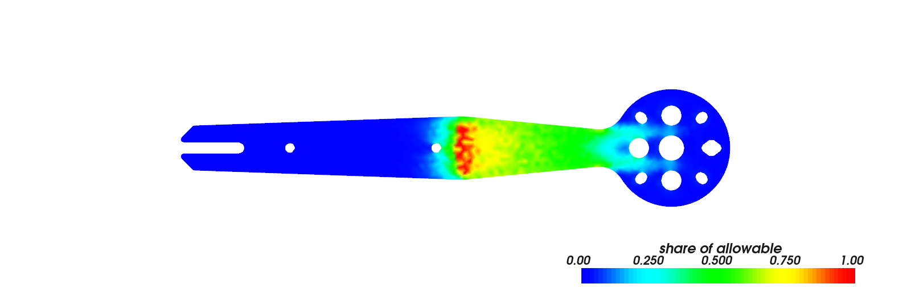
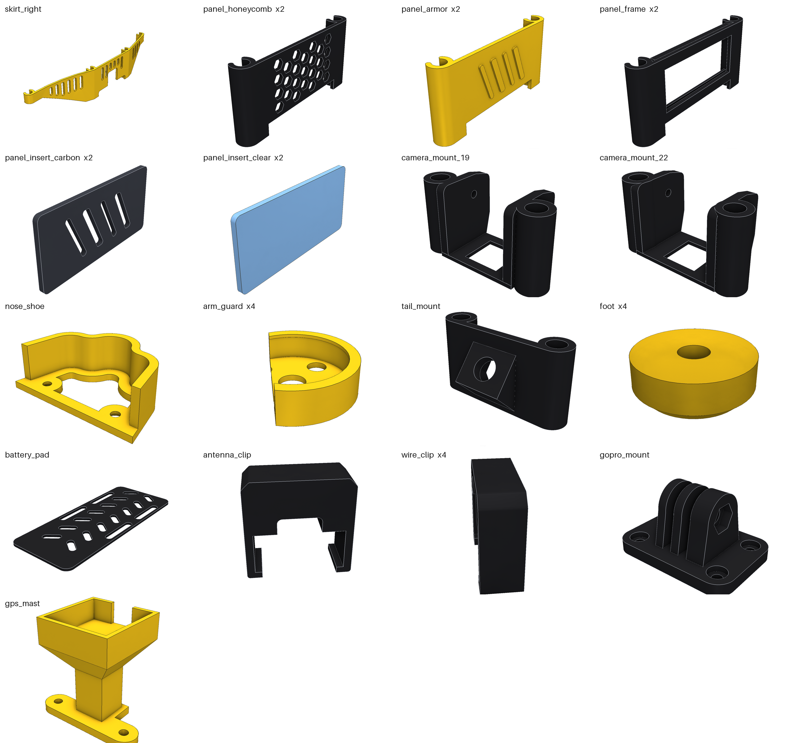

# Tigerbee 7" LR — далекий політ у стилі Tiger Beetle

Семидюймова рама для далеких польотів, у стилі твоєї Tiger Beetle. Далекий політ — це двадцять хвилин на частковому газі, тож важливо, щоб промені не резонували на крейсерських обертах, GPS чув небо, а не передавач, і обидві радіолінії мали чисті антени. Ця папка раніше містила одну зі старих спроб відтворити Tiger Beetle; тепер тут нова рама з нуля.



> **Стан.** CAD-модель на тому ж рушії, що й решта рам репозиторію: усі геометричні перевірки й тести проходять,
> промінь порахований балковою моделлю і FEA. Нічого не вирізали, не друкували й не літали.

Усі картинки — у [галереї](exports/GALLERY.md).

## Коротко

| | |
|---|---|
| Схема | **справжній X**, база 315 мм, 7" гвинти (на семидюймі мотори досить далеко, щоб X не заважав) |
| Промені | **8 мм** у сендвічі, 20 мм на виході, 12 мм біля мотора; болт на 62 мм — підлога тримає перші 70 мм |
| Підлога | сендвіч: обшивки 2 + 1,5 мм, промені й ободи носа та хвоста між ними |
| Стійки | 8 однакових M3×30 |
| Обладнання | стек 30,5, VTX 20 / 30,5, камера 19 або 22 мм, батарея до 46×110×46 (6S LiPo або 6S1P 21700), GPS на щоглі, T-антена приймача на промені |
| Карбон | **244 г** |
| Аксесуари | 18 видів, у збірці ≈ 84 г друку |

## 1. Від Tiger Beetle — і що виправлено

Взято від твоєї рами: ніс із двома вушками й горбиком, хвіст на двох «копитцях», довга дека з вилкою під камеру
й шевронами вздовж, ромб на кінці променя за мотором.

| | Tiger Beetle | Тут |
|---|---|---|
| GPS | на деці, поруч із передавачем і карбоном | на щоглі 40 мм над декою, позаду батареї |
| Антени | одна SMA на хвості | SMA передавача на хвості + T-антена приймача на задньому промені, на долоню одна від одної |
| Промені | 5 мм, різні кути спереду й ззаду | 8 мм, справжній X; частота вище за крейсерські оберти |
| Підлога | дві пластини, що перекриваються | сендвіч на всю довжину |

## 2. Промінь: розрахунок

Балкова модель (`zhalo.structure`), вільна частина променя, мотор із гвинтом на кінці:

| Варіант | Маса, г | Сила до руйнування верт. / бічна, Н | Частота, Гц |
|---|---|---|---|
| 6 мм, 22→12, болт на 56 | 7,6 | 1101 / 3501 | 274 |
| 7 мм, 20→12, болт на 60 | 7,6 | 1443 / 3890 | 365 |
| **8 мм, 20→12, болт на 62 (обрано)** | 8,3 | 1941 / 4531 | 466 |

Обраний промінь у 3D-FEA (ортотропний карбон 0/90, затиснутий під ногами обшивок):

| | |
|---|---|
| Вертикальна сила до 600 МПа | **1676 Н** |
| Бічна сила до 600 МПа | **4035 Н** |
| Жорсткість верт. / бічна | 368 / 1216 Н/мм |
| Перша власна частота | **365 Гц** (≈ 21 900 об/хв) |
| Маса променя | 37,3 г |




Балкова модель завищує частоту приблизно на 15 % (не бачить податливості затиску), тож абсолютні числа — з FEA.
600 МПа — обережна межа для тканини 0/90 **уздовж волокон**: промені різати вздовж волокон.

## 3. Аксесуари



**Бокові панелі — шість варіантів:** спідниця з зябрами (стоїть у збірці) і п'ять на стійки стека, які можна
поставити замість неї: стільникова, броня з рельєфними смугами тигра, **композитна** (TPU-рамка + карбонова
вставка 1,5 мм із вирізаними смугами, `cnc/panel_insert_carbon_1.5mm.dxf`) і **LED** (та сама рамка + прозорий
полікарбонат 1,5 мм, за ним 5-мм LED-стрічка, `cnc/panel_insert_clear_1.5mm.dxf`).

| Деталь | Матеріал | К-сть | Маса, г | Розмір, мм |
|---|---|---|---|---|
| `skirt_right` — Skirt (side panel), right | TPU 95A | 1 | 7,1 | 18 × 167 × 30 |
| `skirt_left` — Skirt (side panel), left | TPU 95A | 1 | 7,1 | 18 × 167 × 30 |
| `panel_honeycomb` — Side panel, honeycomb *(варіант)* | TPU 95A | 2 | 3,8 | 7 × 62 × 30 |
| `panel_armor` — Side panel, armor *(варіант)* | TPU 95A | 2 | 4,6 | 8 × 62 × 30 |
| `panel_frame` — Composite side panel, TPU frame *(варіант)* | TPU 95A | 2 | 3,8 | 30 × 62 × 7 |
| `panel_insert_carbon` — Composite side panel, carbon insert (CNC) *(варіант)* | Carbon 1.5 mm | 2 | 1,8 | 21 × 43 × 2 |
| `panel_insert_clear` — LED side panel, clear insert (CNC or laser) *(варіант)* | Polycarbonate 1.5 mm | 2 | 1,6 | 21 × 43 × 2 |
| `camera_mount_19` — Camera mount, micro 19 mm | TPU 95A | 1 | 4,6 | 40 × 18 × 22 |
| `camera_mount_22` — Camera mount, mini 22 mm *(варіант)* | TPU 95A | 1 | 4,1 | 40 × 18 × 22 |
| `nose_shoe` — Nose shoe (bumper) | TPU 95A | 1 | 6,8 | 52 × 34 × 17 |
| `arm_guard` — Arm guard | TPU 95A | 4 | 4,3 | 40 × 40 × 11 |
| `tail_mount` — Tail mount: VTX antenna (SMA) | TPU 95A | 1 | 4,4 | 40 × 16 × 22 |
| `foot` — Foot | TPU 95A | 4 | 0,6 | 13 × 13 × 4 |
| `battery_pad` — Battery pad | TPU 95A | 1 | 7,6 | 46 × 110 × 2 |
| `antenna_clip` — Receiver antenna clip (T antenna) | TPU 95A | 1 | 1,8 | 28 × 28 × 9 |
| `wire_clip` — Motor-wire clip | TPU 95A | 4 | 0,6 | 20 × 20 × 6 |
| `gopro_mount` — Action-camera mount (GoPro prongs) | TPU 95A | 1 | 9,1 | 42 × 29 × 23 |
| `gps_mast` — GPS mast | TPU 95A | 1 | 13,2 | 41 × 29 × 40 |

TPU 95A, сопло 0,4 мм. Кожна друкована деталь перевірена: не ріже раму, не зачіпає електроніку й диски гвинтів,
лягає на стіл пласкою гранню, друкується без підтримок, без стінок тонших за 0,9 мм; деталі у збірці не перетинаються.

## 4. Що замовляти

| Деталь | Товщина | К-сть | Файл |
|---|---|---|---|
| plate_bottom | 2,0 мм | 1 | `cnc/plate_bottom_2mm.dxf` |
| plate_mid | 1,5 мм | 1 | `cnc/plate_mid_1.5mm.dxf` |
| plate_top | 2,0 мм | 1 | `cnc/plate_top_2mm.dxf` |
| arm | 8,0 мм | 4 | `cnc/arm_8mm_x4.dxf` |
| core_nose | 8,0 мм | 1 | `cnc/core_nose_8mm.dxf` |
| core_tail | 8,0 мм | 1 | `cnc/core_tail_8mm.dxf` |

Усі контури — дуги й відрізки, найменший радіус 1 мм (фреза 2 мм), перемички ≥ 2 мм.
Метизи — у `exports/manifest.json` (`bom`).

## 5. Код

```bash
uv sync
uv run python -m tigerbee_lr check     # усі перевірки
uv run python -m tigerbee_lr analyse   # балкова модель + FEA (потрібна libGLU)
uv run python -m tigerbee_lr all       # exports/: DXF, STEP, STL, 3MF, FreeCAD, рендери, галерея
uv run pytest
```

Стиль Tiger Beetle (контури підлоги, деки, променя) — спільний модуль рушія `zhalo/tiger.py`; аксесуари сімейства —
`zhalo/accessories/tiger_*.py`. Розміри цієї рами — у `src/tigerbee_lr/__init__.py`.

## Що не перевірено

- Нічого не виготовлено; посадки TPU взяті з правил, що працюють на інших рамах репозиторію.
- FEA рахує один промінь, жорстко затиснутий; реальна частота буде трохи нижчою.
- Розміри обладнання (стек, передавач, камера, батарея) — типові оболонки, а не конкретні моделі.
