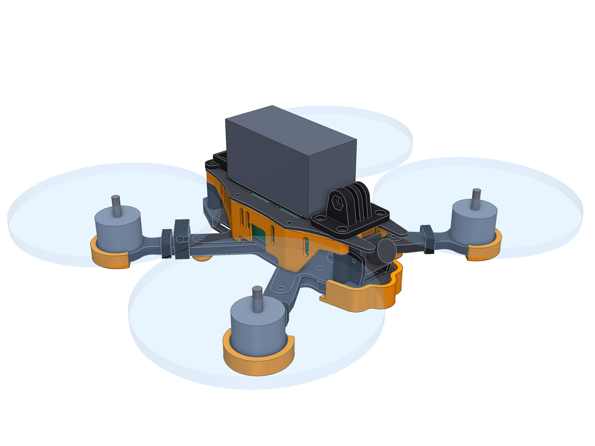
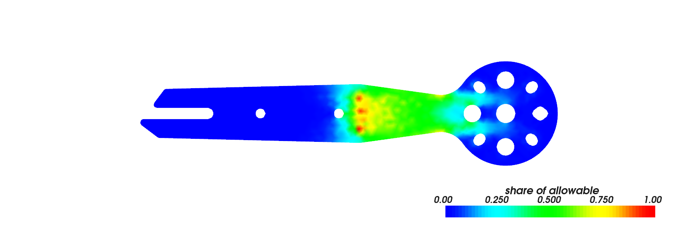
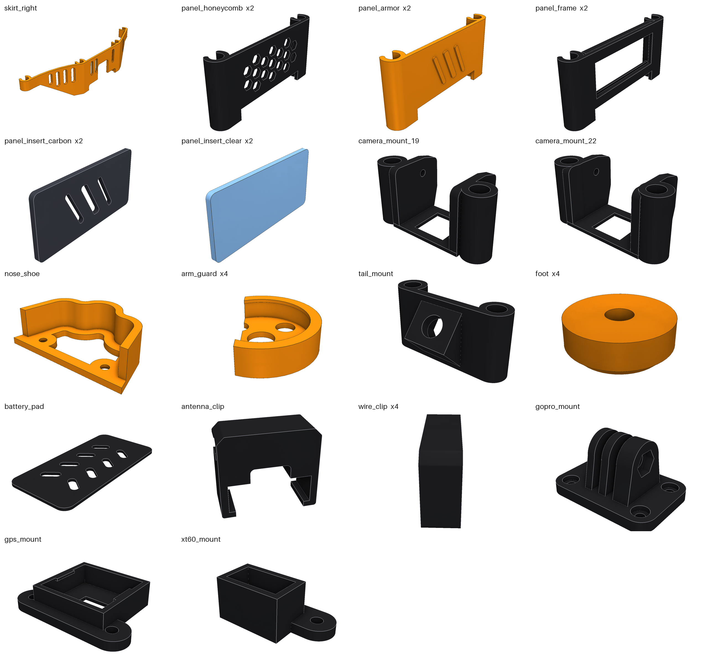

# Tigerbee 5" — фрістайл у стилі Tiger Beetle

П'ятидюймовий фрістайл, що бере у твоєї Tiger Beetle її обличчя — вушка й горбик на носі, «копитця» на хвості, деку з вилкою під камеру й шевронами, ромб за мотором — і виправляє те, що в ній погано. Ця папка раніше містила одну зі старих спроб відтворити Tiger Beetle; тепер тут нова рама з нуля (стара — в історії git, сама рама відтворена в [Tigerbeetle-7inch](../Tigerbeetle-7inch)).



> **Стан.** CAD-модель на тому ж рушії, що й решта рам репозиторію: усі геометричні перевірки й тести проходять,
> промінь порахований балковою моделлю і FEA. Нічого не вирізали, не друкували й не літали.

Усі картинки — у [галереї](exports/GALLERY.md).

## Коротко

| | |
|---|---|
| Схема | широкий X, база 225 мм, 5,1" гвинти (гвинти винесені вбік, поза поле зору камери) |
| Промені | **6 мм**, 18 мм на виході із сендвіча, 11 мм біля мотора; болт на 40 мм |
| Підлога | сендвіч: обшивки 2 + 1,5 мм, промені й ободи носа та хвоста між ними |
| Стійки | 8 однакових M3×28 |
| Обладнання | стек 30,5, аналоговий VTX 20 / 30,5 ззаду, камера 19 або 22 мм, GoPro зверху |
| Карбон | **145 г** |
| Аксесуари | 19 видів, у збірці ≈ 62 г друку |

## 1. Від Tiger Beetle — і що виправлено

Взято від твоєї рами: ніс із двома вушками й горбиком, хвіст на двох «копитцях», довга дека з вилкою під камеру
й шевронами вздовж, ромб на кінці променя за мотором.

| | Tiger Beetle | Тут |
|---|---|---|
| Схема | передні й задні промені Tiger Beetle стоять під різними кутами (33° і 40°) | однаковий кут спереду й ззаду, широкий X |
| Підлога | дві пластини, що перекриваються лише частково | сендвіч на всю довжину: дві обшивки, промені й ободи між ними |
| Промені | 5 мм, ширина «на око» | 6 мм, ширина за епюрою моменту; та сама маса, удвічі більше навантаження |
| Стійки | двох довжин на двох рівнях | 8 однакових на одній палубі |

## 2. Промінь: розрахунок

Балкова модель (`zhalo.structure`), вільна частина променя, мотор із гвинтом на кінці:

| Варіант | Маса, г | Сила до руйнування верт. / бічна, Н | Частота, Гц |
|---|---|---|---|
| 5 мм, 15→11, болт на 30 (як Zhalo) | 3,5 | 673 / 2019 | 312 |
| 6 мм, 16→10,5, болт на 36 (як Strila) | 3,7 | 1177 / 3091 | 507 |
| **6 мм, 18→11, болт на 40 (обрано)** | 3,5 | 1442 / 3804 | 608 |

Обраний промінь у 3D-FEA (ортотропний карбон 0/90, затиснутий під ногами обшивок):

| | |
|---|---|
| Вертикальна сила до 600 МПа | **1195 Н** |
| Бічна сила до 600 МПа | **3130 Н** |
| Жорсткість верт. / бічна | 412 / 1711 Н/мм |
| Перша власна частота | **457 Гц** (≈ 27 400 об/хв) |
| Маса променя | 18,9 г |




Балкова модель завищує частоту приблизно на 15 % (не бачить податливості затиску), тож абсолютні числа — з FEA.
600 МПа — обережна межа для тканини 0/90 **уздовж волокон**: промені різати вздовж волокон.

## 3. Аксесуари



**Бокові панелі — шість варіантів:** спідниця з зябрами (стоїть у збірці) і п'ять на стійки стека, які можна
поставити замість неї: стільникова, броня з рельєфними смугами тигра, **композитна** (TPU-рамка + карбонова
вставка 1,5 мм із вирізаними смугами, `cnc/panel_insert_carbon_1.5mm.dxf`) і **LED** (та сама рамка + прозорий
полікарбонат 1,5 мм, за ним 5-мм LED-стрічка, `cnc/panel_insert_clear_1.5mm.dxf`).

| Деталь | Матеріал | К-сть | Маса, г | Розмір, мм |
|---|---|---|---|---|
| `skirt_right` — Skirt (side panel), right | TPU 95A | 1 | 5,9 | 21 × 135 × 28 |
| `skirt_left` — Skirt (side panel), left | TPU 95A | 1 | 5,9 | 21 × 135 × 28 |
| `panel_honeycomb` — Side panel, honeycomb *(варіант)* | TPU 95A | 2 | 3,6 | 7 × 58 × 28 |
| `panel_armor` — Side panel, armor *(варіант)* | TPU 95A | 2 | 4,1 | 8 × 58 × 28 |
| `panel_frame` — Composite side panel, TPU frame *(варіант)* | TPU 95A | 2 | 3,6 | 28 × 58 × 7 |
| `panel_insert_carbon` — Composite side panel, carbon insert (CNC) *(варіант)* | Carbon 1.5 mm | 2 | 1,6 | 19 × 40 × 2 |
| `panel_insert_clear` — LED side panel, clear insert (CNC or laser) *(варіант)* | Polycarbonate 1.5 mm | 2 | 1,3 | 19 × 40 × 2 |
| `camera_mount_19` — Camera mount, micro 19 mm | TPU 95A | 1 | 4,2 | 40 × 18 × 20 |
| `camera_mount_22` — Camera mount, mini 22 mm *(варіант)* | TPU 95A | 1 | 3,8 | 40 × 18 × 20 |
| `nose_shoe` — Nose shoe (bumper) | TPU 95A | 1 | 6,0 | 53 × 32 × 15 |
| `arm_guard` — Arm guard | TPU 95A | 4 | 3,1 | 34 × 37 × 9 |
| `tail_mount` — Tail mount: VTX antenna (SMA) | TPU 95A | 1 | 3,9 | 38 × 16 × 20 |
| `foot` — Foot | TPU 95A | 4 | 0,6 | 13 × 13 × 4 |
| `battery_pad` — Battery pad | TPU 95A | 1 | 5,1 | 38 × 78 × 2 |
| `antenna_clip` — Receiver antenna clip (T antenna) | TPU 95A | 1 | 1,7 | 26 × 27 × 9 |
| `wire_clip` — Motor-wire clip | TPU 95A | 4 | 0,6 | 20 × 21 × 6 |
| `gopro_mount` — Action-camera mount (GoPro prongs) | TPU 95A | 1 | 9,1 | 42 × 29 × 23 |
| `gps_mount` — GPS tray | TPU 95A | 1 | 2,7 | 39 × 27 × 8 |
| `xt60_mount` — XT60 holder *(варіант)* | TPU 95A | 1 | 2,5 | 39 × 16 × 12 |

TPU 95A, сопло 0,4 мм. Кожна друкована деталь перевірена: не ріже раму, не зачіпає електроніку й диски гвинтів,
лягає на стіл пласкою гранню, друкується без підтримок, без стінок тонших за 0,9 мм; деталі у збірці не перетинаються.

## 4. Що замовляти

| Деталь | Товщина | К-сть | Файл |
|---|---|---|---|
| plate_bottom | 2,0 мм | 1 | `cnc/plate_bottom_2mm.dxf` |
| plate_mid | 1,5 мм | 1 | `cnc/plate_mid_1.5mm.dxf` |
| plate_top | 2,0 мм | 1 | `cnc/plate_top_2mm.dxf` |
| arm | 6,0 мм | 4 | `cnc/arm_6mm_x4.dxf` |
| core_nose | 6,0 мм | 1 | `cnc/core_nose_6mm.dxf` |
| core_tail | 6,0 мм | 1 | `cnc/core_tail_6mm.dxf` |

Усі контури — дуги й відрізки, найменший радіус 1 мм (фреза 2 мм), перемички ≥ 2 мм.
Метизи — у `exports/manifest.json` (`bom`).

## 5. Код

```bash
uv sync
uv run python -m tigerbee check     # усі перевірки
uv run python -m tigerbee analyse   # балкова модель + FEA (потрібна libGLU)
uv run python -m tigerbee all       # exports/: DXF, STEP, STL, 3MF, FreeCAD, рендери, галерея
uv run pytest
```

Стиль Tiger Beetle (контури підлоги, деки, променя) — спільний модуль рушія `zhalo/tiger.py`; аксесуари сімейства —
`zhalo/accessories/tiger_*.py`. Розміри цієї рами — у `src/tigerbee/__init__.py`.

## Що не перевірено

- Нічого не виготовлено; посадки TPU взяті з правил, що працюють на інших рамах репозиторію.
- FEA рахує один промінь, жорстко затиснутий; реальна частота буде трохи нижчою.
- Розміри обладнання (стек, передавач, камера, батарея) — типові оболонки, а не конкретні моделі.
