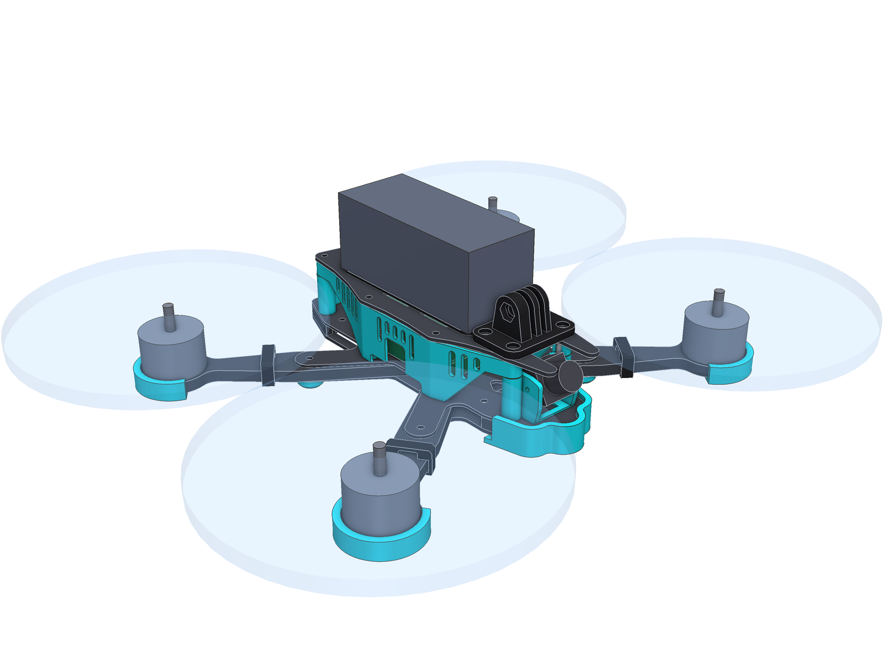
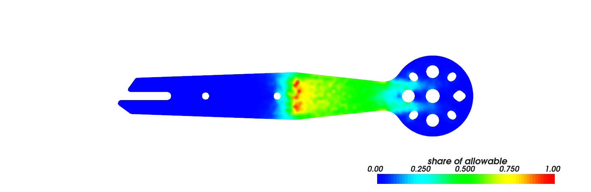
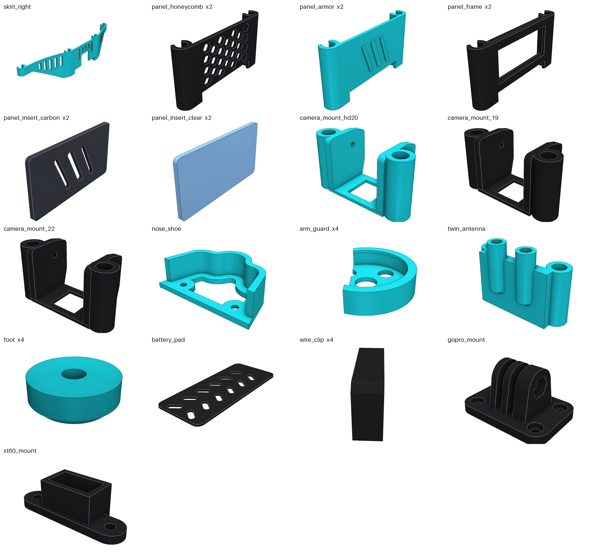

# Tigerbeetle V2 6" HD — під цифрову відеосистему

Шестидюймова рама під цифрову HD-систему, у стилі твоєї Tiger Beetle. Цифрові системи хочуть від рами свого: високий задній відсік під передавач із вентилятором, кріплення 20-мм HD-камери, дві антени, рознесені на хвості, і гвинти поза ширококутним полем зору. Ця папка раніше містила одну зі старих спроб відтворити Tiger Beetle; тепер тут нова рама з нуля.



> **Стан.** CAD-модель на тому ж рушії, що й решта рам репозиторію: усі геометричні перевірки й тести проходять,
> промінь порахований балковою моделлю і FEA. Нічого не вирізали, не друкували й не літали.

Усі картинки — у [галереї](exports/GALLERY.md).

## Коротко

| | |
|---|---|
| Схема | широкий X, база 265 мм, 6" гвинти (винесені вбік, поза поле зору HD-камери) |
| Промені | **6 мм**, 20 мм на виході із сендвіча, 12 мм біля мотора; болт на 46 мм |
| Підлога | сендвіч: обшивки 2 + 1,5 мм, промені й ободи носа та хвоста між ними |
| Стійки | 8 однакових M3×30 (передавач із вентилятором вищий за аналоговий) |
| Обладнання | стек 30,5; цифровий передавач до 36×36×15 мм на 30,5 / 20; HD-камера 20 мм (є кріплення 19 і 22 мм); дві антени |
| Карбон | **173 г** |
| Аксесуари | 18 видів, у збірці ≈ 64 г друку |

## 1. Від Tiger Beetle — і що виправлено

Взято від твоєї рами: ніс із двома вушками й горбиком, хвіст на двох «копитцях», довга дека з вилкою під камеру
й шевронами вздовж, ромб на кінці променя за мотором.

| | Tiger Beetle | Тут |
|---|---|---|
| Відсік передавача | низький, під аналоговий VTX | 30 мм висоти, отвори 30,5 і 20, вікно під вентилятор |
| Камера | кріплення під аналогову 19 мм | HD 20 мм за замовчуванням, 19 і 22 мм — варіанти |
| Антени | одна SMA | дві трубки під 70° одна до одної, нахилені назад — поза гвинтами й боковими панелями |
| Схема і підлога | різні кути променів, дві пластини, що перекриваються | широкий X, сендвіч на всю довжину |

## 2. Промінь: розрахунок

Балкова модель (`zhalo.structure`), вільна частина променя, мотор із гвинтом на кінці:

| Варіант | Маса, г | Сила до руйнування верт. / бічна, Н | Частота, Гц |
|---|---|---|---|
| 6 мм, 18→11, болт на 40 | 5,9 | 998 / 2927 | 314 |
| **6 мм, 20→12, болт на 46 (обрано)** | 5,5 | 1243 / 3874 | 394 |
| 7 мм, 18→11, болт на 46 | 5,8 | 1522 / 3725 | 472 |

Обраний промінь у 3D-FEA (ортотропний карбон 0/90, затиснутий під ногами обшивок):

| | |
|---|---|
| Вертикальна сила до 600 МПа | **1091 Н** |
| Бічна сила до 600 МПа | **3409 Н** |
| Жорсткість верт. / бічна | 232 / 1252 Н/мм |
| Перша власна частота | **317 Гц** (≈ 19 000 об/хв) |
| Маса променя | 23,7 г |



Перша власна частота за FEA — **317 Гц**, це ≈ 19 000 об/хв. Вище за оберти 6" мотора на висінні, але запас менший, ніж на інших рамах; якщо літаєш агресивно з важкою HD-камерою — 7-мм промінь (рядок 3) дає ще +25 %.

Балкова модель завищує частоту приблизно на 15 % (не бачить податливості затиску), тож абсолютні числа — з FEA.
600 МПа — обережна межа для тканини 0/90 **уздовж волокон**: промені різати вздовж волокон.

## 3. Аксесуари



**Бокові панелі — шість варіантів:** спідниця з зябрами (стоїть у збірці) і п'ять на стійки стека, які можна
поставити замість неї: стільникова, броня з рельєфними смугами тигра, **композитна** (TPU-рамка + карбонова
вставка 1,5 мм із вирізаними смугами, `cnc/panel_insert_carbon_1.5mm.dxf`) і **LED** (та сама рамка + прозорий
полікарбонат 1,5 мм, за ним 5-мм LED-стрічка, `cnc/panel_insert_clear_1.5mm.dxf`).

| Деталь | Матеріал | К-сть | Маса, г | Розмір, мм |
|---|---|---|---|---|
| `skirt_right` — Skirt (side panel), right | TPU 95A | 1 | 6,6 | 20 × 149 × 30 |
| `skirt_left` — Skirt (side panel), left | TPU 95A | 1 | 6,6 | 20 × 149 × 30 |
| `panel_honeycomb` — Side panel, honeycomb *(варіант)* | TPU 95A | 2 | 3,7 | 7 × 58 × 30 |
| `panel_armor` — Side panel, armor *(варіант)* | TPU 95A | 2 | 4,4 | 8 × 58 × 30 |
| `panel_frame` — Composite side panel, TPU frame *(варіант)* | TPU 95A | 2 | 3,7 | 30 × 58 × 7 |
| `panel_insert_carbon` — Composite side panel, carbon insert (CNC) *(варіант)* | Carbon 1.5 mm | 2 | 1,7 | 21 × 39 × 2 |
| `panel_insert_clear` — LED side panel, clear insert (CNC or laser) *(варіант)* | Polycarbonate 1.5 mm | 2 | 1,5 | 21 × 39 × 2 |
| `camera_mount_hd20` — HD camera mount, 20 mm | TPU 95A | 1 | 4,5 | 40 × 18 × 22 |
| `camera_mount_19` — Camera mount, micro 19 mm *(варіант)* | TPU 95A | 1 | 4,6 | 40 × 18 × 22 |
| `camera_mount_22` — Camera mount, mini 22 mm *(варіант)* | TPU 95A | 1 | 4,1 | 40 × 18 × 22 |
| `nose_shoe` — Nose shoe (bumper) | TPU 95A | 1 | 6,0 | 53 × 33 × 15 |
| `arm_guard` — Arm guard | TPU 95A | 4 | 3,4 | 36 × 39 × 9 |
| `twin_antenna` — Twin antenna mount | TPU 95A | 1 | 5,7 | 40 × 15 × 28 |
| `foot` — Foot | TPU 95A | 4 | 0,6 | 13 × 13 × 4 |
| `battery_pad` — Battery pad | TPU 95A | 1 | 6,4 | 40 × 95 × 2 |
| `wire_clip` — Motor-wire clip | TPU 95A | 4 | 0,7 | 22 × 24 × 6 |
| `gopro_mount` — Action-camera mount (GoPro prongs) | TPU 95A | 1 | 9,1 | 42 × 29 × 23 |
| `xt60_mount` — XT60 holder *(варіант)* | TPU 95A | 1 | 2,4 | 41 × 14 × 12 |

TPU 95A, сопло 0,4 мм. Кожна друкована деталь перевірена: не ріже раму, не зачіпає електроніку й диски гвинтів,
лягає на стіл пласкою гранню, друкується без підтримок, без стінок тонших за 0,9 мм; деталі у збірці не перетинаються.

## 4. Що замовляти

| Деталь | Товщина | К-сть | Файл |
|---|---|---|---|
| plate_bottom | 2,0 мм | 1 | `cnc/plate_bottom_2mm.dxf` |
| plate_mid | 1,5 мм | 1 | `cnc/plate_mid_1.5mm.dxf` |
| plate_top | 2,0 мм | 1 | `cnc/plate_top_2mm.dxf` |
| arm | 6,0 мм | 4 | `cnc/arm_6mm_x4.dxf` |
| core_nose | 6,0 мм | 1 | `cnc/core_nose_6mm.dxf` |
| core_tail | 6,0 мм | 1 | `cnc/core_tail_6mm.dxf` |

Усі контури — дуги й відрізки, найменший радіус 1 мм (фреза 2 мм), перемички ≥ 2 мм.
Метизи — у `exports/manifest.json` (`bom`).

## 5. Код

```bash
uv sync
uv run python -m tigerbeetle_v2 check     # усі перевірки
uv run python -m tigerbeetle_v2 analyse   # балкова модель + FEA (потрібна libGLU)
uv run python -m tigerbeetle_v2 all       # exports/: DXF, STEP, STL, 3MF, FreeCAD, рендери, галерея
uv run pytest
```

Стиль Tiger Beetle (контури підлоги, деки, променя) — спільний модуль рушія `zhalo/tiger.py`; аксесуари сімейства —
`zhalo/accessories/tiger_*.py`. Розміри цієї рами — у `src/tigerbeetle_v2/__init__.py`.

## Що не перевірено

- Нічого не виготовлено; посадки TPU взяті з правил, що працюють на інших рамах репозиторію.
- FEA рахує один промінь, жорстко затиснутий; реальна частота буде трохи нижчою.
- Розміри обладнання (стек, передавач, камера, батарея) — типові оболонки, а не конкретні моделі.
