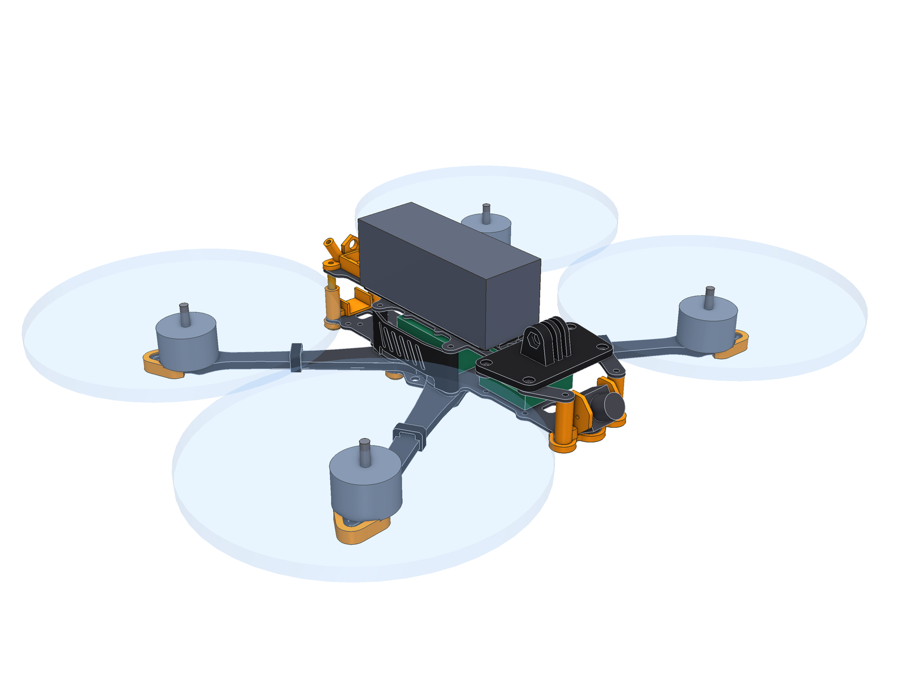
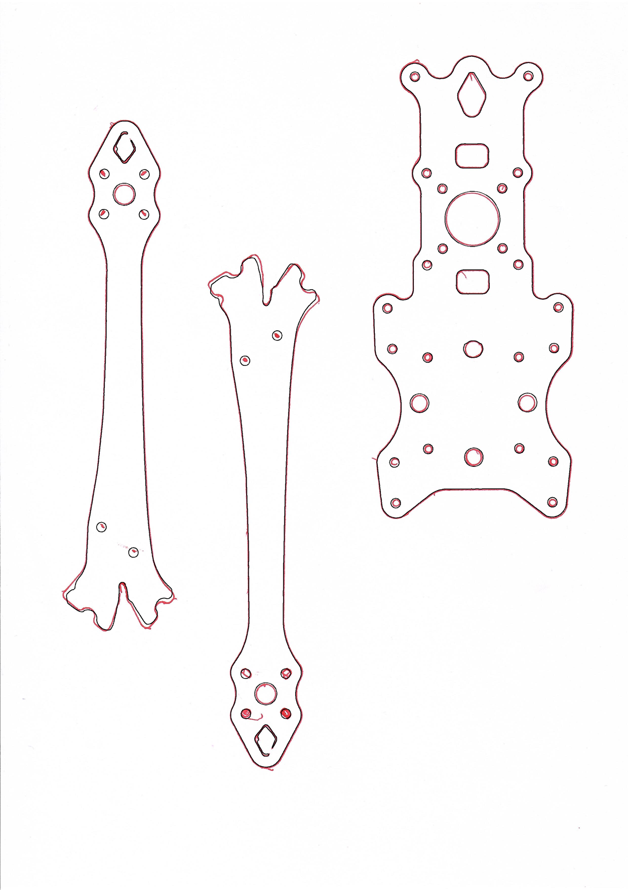
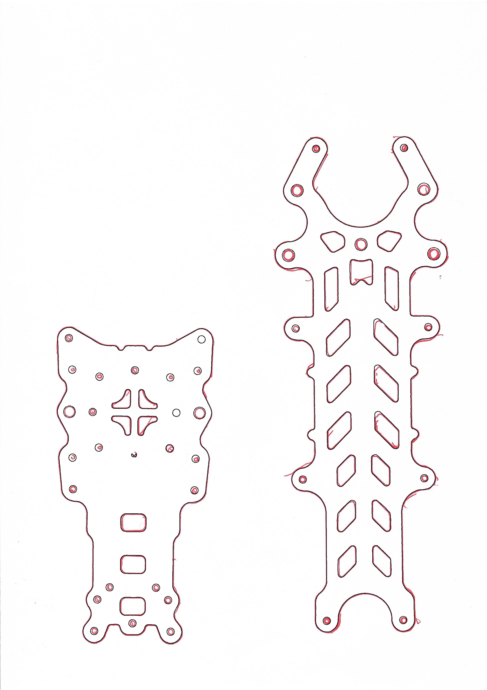
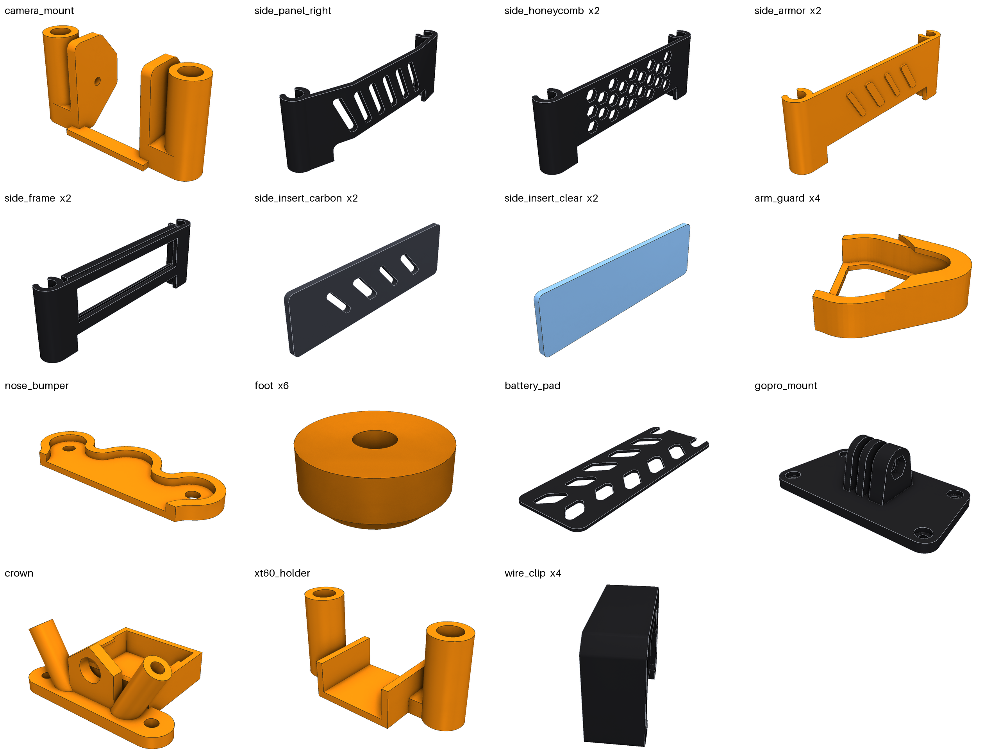
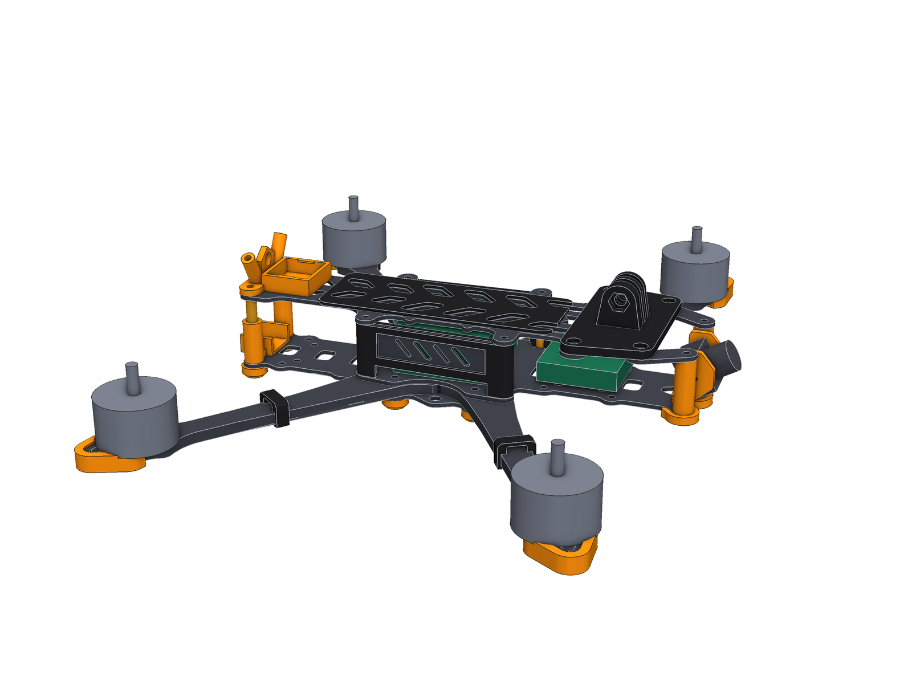
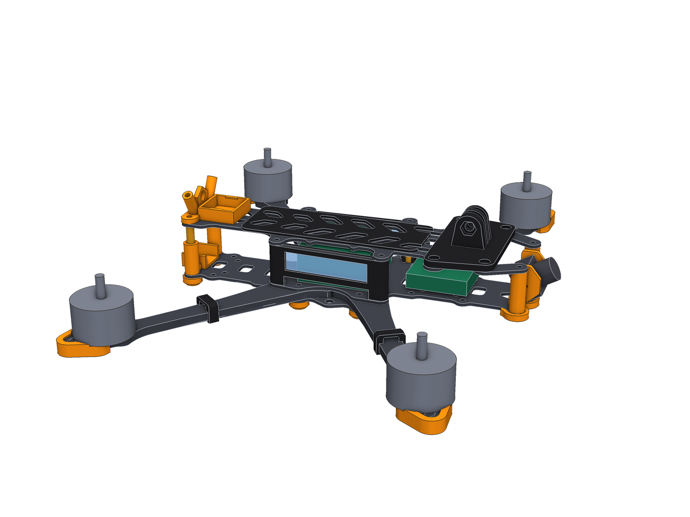
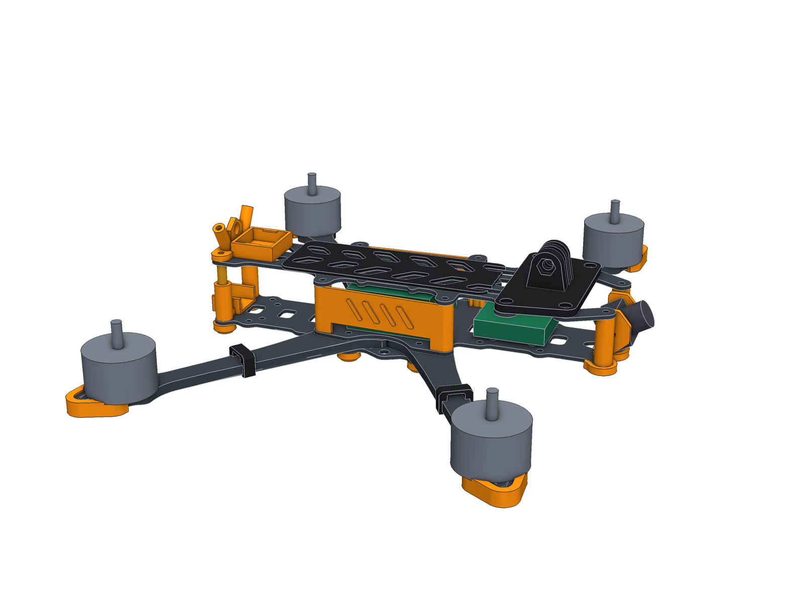

# Tiger Beetle 7" — відтворена зі сканів

Твоя рама Tiger Beetle, відтворена **прямо з обводки**: контури взяті з червоної лінії ручки на двох
аркушах A4, а не намальовані наново. Модель накладена назад на скани, і відхилення виміряне
(розділ 1). Поверх неї — перевірки складання і повний комплект друкованих аксесуарів.



> **Стан.** CAD-модель, перевірена кодом (48 перевірок рами, 17 тестів). Нічого не вирізали
> і не друкували. Товщини, висота між пластинами і розміри великих отворів — припущення, позначені нижче
> (розділ 2, «Що треба звірити з рамою в руках»).

Усі картинки — у [галереї](exports/GALLERY.md). Файли для фрезерування — `exports/cnc/`, для друку —
`exports/print/`, збірки й FreeCAD — `exports/assembly/`.

## Коротко

| | |
|---|---|
| Деталі | нижня пластина, камерна пластина, верхня дека (по 2 мм), промінь 5 мм × 4 |
| Мотори | діагональ **304,2 мм**, передні під 33,4° до осі X, задні під 40,2° |
| Стійки | 6 × 25 мм (на камерній пластині) + 2 × 32 мм (ззаду, на нижній) |
| Стек | 30,5 × 30,5 — він і є початком координат |
| Передній відсік | 30,5 × 30,5 і 20 × 20 на камерній пластині (VTX), камера 19 мм |
| Карбон | **165 г** |
| Аксесуари | 16 видів: 5 варіантів бокових панелей, бампери, ніжки, тримачі камери, GoPro, GPS, XT60 |

## 1. Як відтворено і наскільки точно

Попередні три спроби (`Tigerbee`, `Tigerbee 7inch`, `Tigerbeetle V2`) малювали контури наново лініями й
дугами «за мотивами» скану і підганяли їх руками. Тут навпаки — геометрію бере машина з самого чорнила:

1. **Чорнило.** Червоне відокремлюється від паперу; скан 300 dpi, тобто 0,0847 мм на піксель.
2. **Матеріал.** Ручку тримали притиснутою до деталі, тож край деталі — внутрішній край лінії контуру
   і зовнішній край лінії кожного вирізу. Подвійні обводки й розриви лінії до 1,4 мм закриваються.
3. **Вісь симетрії** кожної пластини шукається так, щоб пластина найкраще збіглася зі своїм дзеркалом.
4. **Усереднення.** Контур пластини — середнє лівої і дзеркальної правої половин; виріз, обведений хоч на
   одному боці, є на обох (так відновились пропущені отвори). Промінь обведено двічі, з обох боків:
   обидві обводки накладаються й усереднюються. Край згладжується на 0,3 мм (тремтіння руки).
5. **Збірка.** Пластини стають на спільний квадрат стека; промінь стає так, щоб його два кореневі отвори
   лягли на два отвори пластин.

Модель, накладена назад на скани (чорне — модель, червоне — твоя обводка):

| Аркуш 1 | Аркуш 2 |
|---|---|
|  |  |

Відстань від контуру моделі до найближчого чорнила:

| Деталь | Середня | 95 % точок у межах | Найбільша |
|---|---|---|---|
| Камерна пластина | 0,06 мм | 0,17 мм | 0,30 мм |
| Промінь, обводка 1 | 0,14 мм | 0,57 мм | 1,63 мм |
| Промінь, обводка 2 | 0,11 мм | 0,68 мм | 1,02 мм |
| Нижня пластина | 0,06 мм | 0,17 мм | 0,42 мм |
| Верхня дека | 0,05 мм | 0,17 мм | 0,30 мм |

Найбільші відхилення на промені — на кінчиках кореня, де дві обводки розходяться найбільше
(там промінь ще й обрізаний на 0,1 мм від осі, див. нижче).

Що ще підтверджує модель:

- Ліва і права половини пластин як обведені збігаються на 95–98 % площі; дві обводки променя — на 94 %.
- Отвори одного болта на різних пластинах до усереднення розходились не більше ніж на 0,31 мм.
- Обидва розміщення променя (переднє і заднє, дзеркальне) ставлять болт стека в **одну й ту саму**
  точку кореня з розбіжністю 0,1 мм. Це незалежна перевірка, що промені стоять правильно.

## 2. Що вирішено поверх обводки

| Рішення | Чому |
|---|---|
| Початок координат — центр стека 30,5 | Найточніший і найважливіший візерунок рами |
| Отвір, обведений меншим за 3,4 мм, — M3 (Ø3,2) | Ручка не дістає краю малого отвору: M3 обводиться як 2,6–2,8 мм |
| Більший отвір — обведений розмір + 0,5 мм | Та сама поправка на ручку. **Звір штангенциркулем** |
| Отвори одного болта на різних пластинах — в одній точці | Болт мусить пройти всі шари |
| Пари отворів у межах 0,7 мм від 20 / 25,5 / 30,5 — точно на стандарт | Плати мають стандартні отвори |
| Виїмка Ø3,4 у корені променя під болт стека | На обводці виріз кореня на 0,4 мм затісний для болта |
| Корінь обрізано на 0,1 мм від центральної лінії | Кінчики лівого й правого кореня ледь торкались; так роблять і заводські рами |
| Мотор: 4 × M3 на колі Ø19 мм | Як обведено. Це не 16×16 і не 19×19 — **звір зі своїм мотором** |

### Що треба звірити з рамою в руках

- **Товщина пластин.** Узято 2 мм (так записано в `Tigerbeetle V2`); у `Tigerbee` було 3 мм. Це один параметр: `model.T_PLATE`.
- **Висота між камерною пластиною і верхньою декою.** Узято 25 мм; зі сканів її не видно. `model.TOP_GAP`.
- **Великі отвори** (Ø5–6,3 і Ø18,4 на камерній пластині, Ø5,3 на деці) — розмір із поправкою на ручку.
- **Камера.** У 25 мм висоти з нахилом поміщається тільки 19-мм камера. Якщо твоя рама має вищі стійки, 22-мм теж стане.

## 3. Чим ця модель краща за попередні

| | Попередні спроби | Тут |
|---|---|---|
| Звідки контури | намальовані наново за сканом | векторизовані з чорнила, середнє двох сторін / двох обводок |
| Корінь променя | у V2 зменшений до 35 × 29 мм, «щоб не налазив» | як обведений; обрізано лише 0,1 мм на центральній лінії |
| Схема | у Tigerbee примусово квадратний X 305 мм | як показують отвори: передні промені 33,4°, задні 40,2° |
| Доказ | порівняння окремих точок | модель накладена на обидва скани, відхилення виміряне по всьому контуру |
| Аксесуари | захист променів, GoPro | 16 видів, з них 5 варіантів бокових панелей; кожен перевірений на складання й друк без підтримок |

## 4. Перевірки

`tigerbeetle check` перевіряє: що кожна деталь — одне валідне тіло; що деталі не перетинаються; що кожен
болт проходить усі шари, крізь які йде (41 осей), а болт стека не зачіпає промені; що всі 8 стійок
стоять на карбоні і впираються в деку; що 7" гвинти не зачіпають один одного (найменший зазор 4,8 мм)
і корпус; що стек 30,5, VTX 30,5, камера 19 мм у всьому діапазоні нахилу і батарея вміщаються;
найвужчу перемичку карбону; і точність відтворення з розділу 1. Друковані деталі — як на інших рамах
репозиторію: не ріжуть раму, не зачіпають електроніку й гвинти, лягають на стіл пласкою гранню,
друкуються без підтримок, без стінок тонших за 0,9 мм, не перетинаються між собою.

## 5. Аксесуари



### Бокові панелі: п'ять варіантів на ті самі дві стійки

Усі знімаються без інструмента: два кільця клацають на стійки зовні. Внизу посередині — виріз під дроти моторів.

| Варіант | Що це | Для чого |
|---|---|---|
| Вентильована (`side_panel`) | TPU, шість похилих прорізів-«шевронів» | щоденні польоти, стоїть у збірці |
| Стільникова (`side_honeycomb`) | TPU, стільники по всій висоті | найбільше повітря до стека влітку |
| Броня (`side_armor`) | TPU без отворів, рельєфні смуги тигра | пісок, пил, трава, падіння на бік |
| Композитна (`side_frame` + `side_insert_carbon`) | TPU-рамка + карбонова вставка 1,5 мм з вирізаними смугами | найжорсткіша й найлегша на вигляд; вставка — `cnc/side_insert_carbon_1.5mm.dxf` |
| LED (`side_frame` + `side_insert_clear`) | та сама рамка + прозорий полікарбонат 1,5 мм | 5-мм LED-стрічка за вставкою — бік світиться; `cnc/side_insert_clear_1.5mm.dxf` |

| Композитна | LED |
|---|---|
|  |  |
|  |  |

Вставка вставляється в рамку зсередини: TPU-губи по 1,4 мм заходять за її верхній і нижній край. Рамка й
вставка перевірені на взаємне розташування (не перетинаються) і на те, що разом не зачіпають раму й стек.

### Усі деталі

| Деталь | Матеріал | К-сть | Маса, г | Розмір, мм | Метизи |
|---|---|---|---|---|---|
| `camera_mount` — FPV camera mount, 19 mm | TPU 95A | 1 | 5,0 | 47 × 18 × 25 | 2x M2x5 (the camera's own side screws) |
| `side_panel_right` — Side panel, right | TPU 95A | 1 | 3,7 | 12 × 74 × 25 | — |
| `side_panel_left` — Side panel, left | TPU 95A | 1 | 3,7 | 12 × 74 × 25 | — |
| `side_honeycomb` — Side panel, honeycomb *(варіант)* | TPU 95A | 2 | 3,4 | 10 × 74 × 25 | — |
| `side_armor` — Side panel, armor *(варіант)* | TPU 95A | 2 | 4,1 | 10 × 74 × 25 | — |
| `side_frame` — Composite side panel, TPU frame *(варіант)* | TPU 95A | 2 | 3,7 | 28 × 75 × 7 | — |
| `side_insert_carbon` — Composite side panel, carbon insert (CNC) *(варіант)* | Carbon 1.5 mm | 2 | 1,8 | 18 × 55 × 2 | — |
| `side_insert_clear` — LED side panel, clear insert (CNC or laser) *(варіант)* | Polycarbonate 1.5 mm | 2 | 1,5 | 18 × 55 × 2 | — |
| `arm_guard` — Arm guard | TPU 95A | 4 | 1,1 | 29 × 27 × 7 | — |
| `nose_bumper` — Nose bumper | TPU 95A | 1 | 1,8 | 52 × 18 × 4 | the two front-standoff bolts, 2 mm longer |
| `foot` — Foot | TPU 95A | 6 | 0,5 | 12 × 12 × 5 | the bolts it covers, 3 mm longer |
| `battery_pad` — Battery pad | TPU 95A | 1 | 6,1 | 40 × 110 × 2 | — |
| `gopro_mount` — Action-camera mount (GoPro prongs) | TPU 95A | 1 | 16,3 | 74 × 39 × 23 | 4x M3x12 + washer + nyloc (the plate's holes are 5.3 mm), M5 nut + thumbscrew |
| `crown` — Crown (GPS tray and antenna holder) | TPU 95A | 1 | 4,8 | 43 × 33 × 19 | 2x M3x12 (replace the two rear top-plate screws); the SMA socket's own nut |
| `xt60_holder` — XT60 holder | TPU 95A | 1 | 3,2 | 42 × 16 × 20 | a zip tie round the socket and the holder |
| `wire_clip` — Motor-wire clip | TPU 95A | 4 | 0,5 | 17 × 19 × 6 | — |

TPU 95A, сопло 0,4 мм; у збірці ≈ 54 г друку. Помаранчеве — акцент «тигра», чорне — панелі й килимок.

## 6. Файли й метизи

| Деталь | Товщина | Кількість | Файл |
|---|---|---|---|
| Нижня пластина | 2 мм | 1 | `cnc/plate_bottom_2mm.dxf` |
| Камерна пластина | 2 мм | 1 | `cnc/plate_camera_2mm.dxf` |
| Верхня дека | 2 мм | 1 | `cnc/plate_top_2mm.dxf` |
| Промінь | 5 мм | 4 | `cnc/arm_5mm_x4.dxf` |

DXF містить гладкі сплайни (так точніше повторюється обводка); більшість CNC-майстерень їх приймає.
Якщо твоя вимагає тільки дуги й відрізки — попроси перевести, це одна команда в їхньому CAM.

Стійки: 6 × M3×25 і 2 × M3×32, Ø5. Болти коренів і стека: M3 крізь нижню пластину, промінь і камерну
пластину (2 + 5 + 2 = 9 мм) — M3×12 з гайкою, стек — M3×30 з ним разом.

## 7. Код

```bash
cd Tigerbeetle-7inch
uv sync
uv run tigerbeetle trace   # скани -> src/tigerbeetle/data/reconstruction.json (~5 хв)
uv run tigerbeetle check   # усі перевірки
uv run tigerbeetle all     # exports/: DXF, STEP, STL, 3MF, FreeCAD, рендери, накладки, галерея
uv run pytest
```

`trace.py` бере тільки скани; `model.py` містить усі рішення з розділу 2 — кожне можна змінити.
Рендери, експорт і правила друку спільні з іншими рамами репозиторію (пакет `zhalo`).
