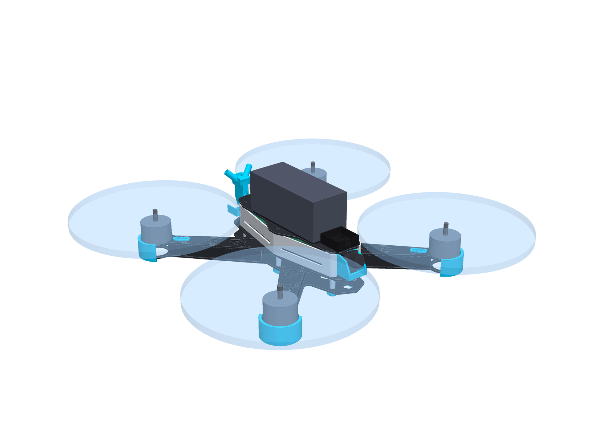
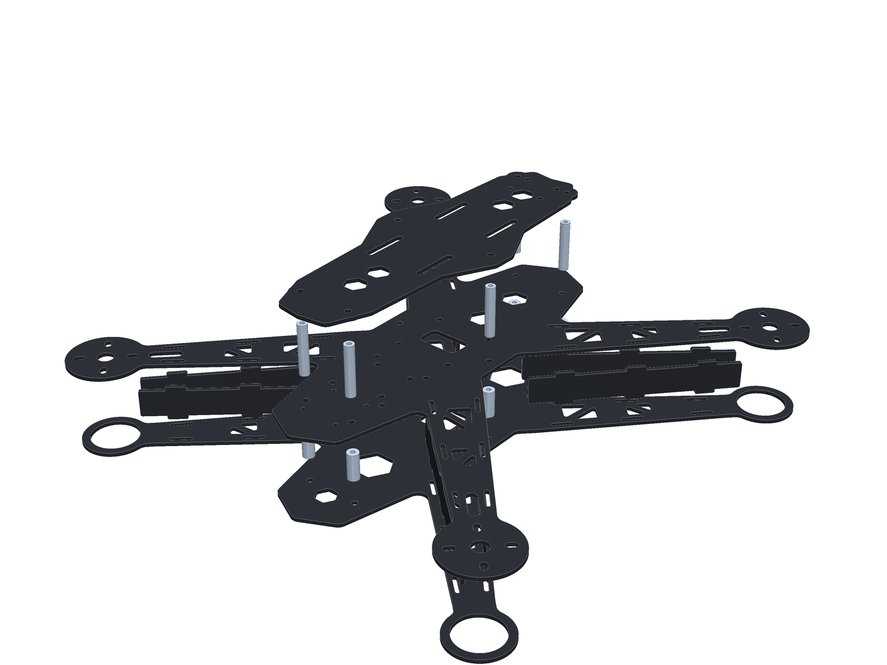
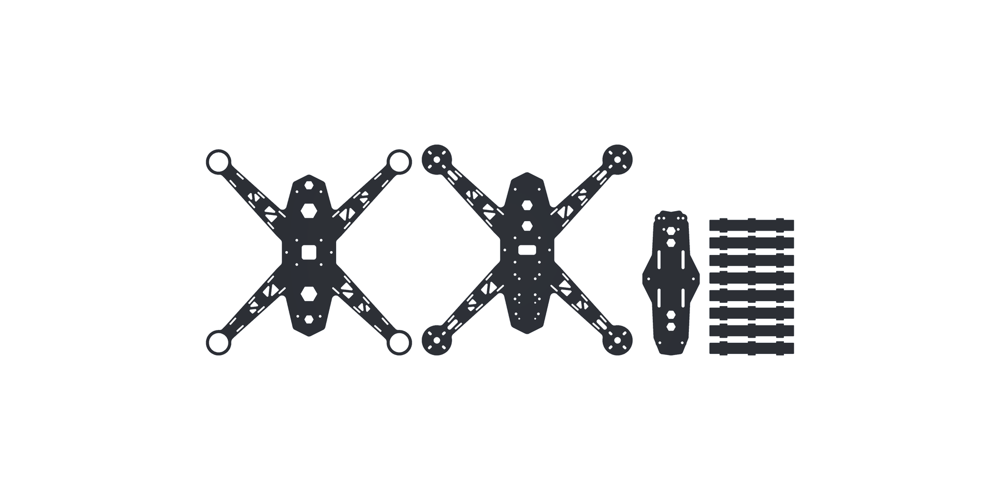
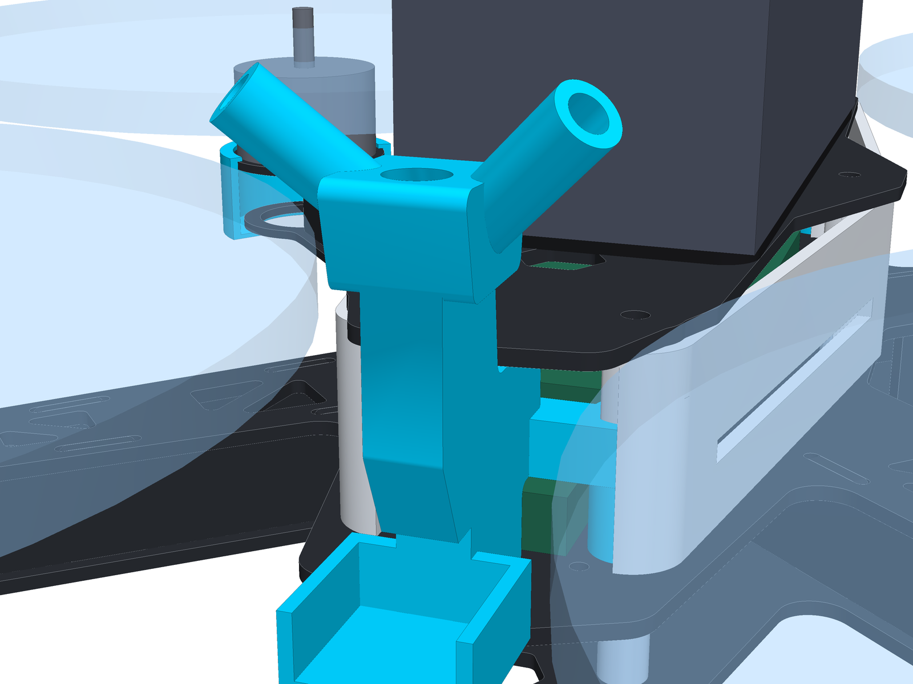
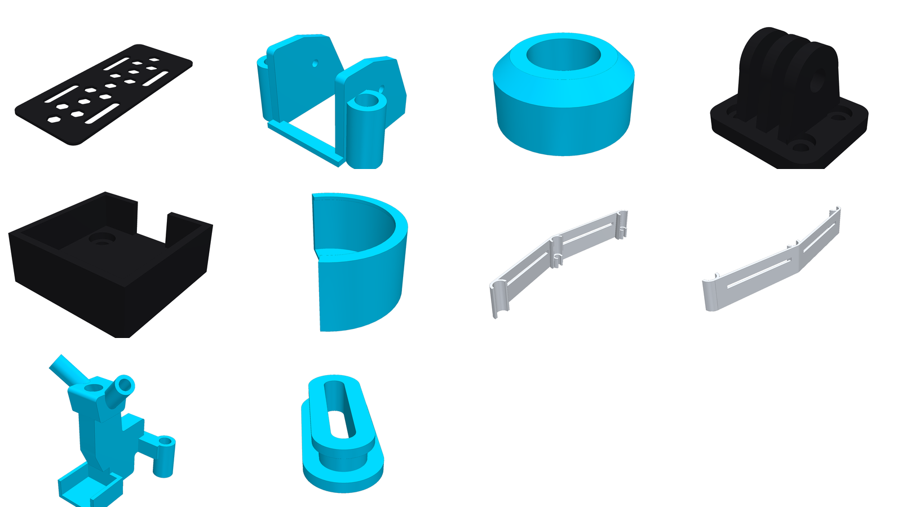

# Vektor 7.5"

Лонг-рейндж рама 7.5" нового типу: **промінь — це коробка, а не пластина**. Дві карбонові обшивки по 2 мм
(нижня «кіль» і верхня «палуба») на відстані 14 мм, між ними в кожному промені — дві карбонові стінки
на шипах. Виходить справжня коробчата балка, як крило літака.

Окремий проєкт: власний код, власні перевірки, рендер і експорт. Нічого не взято з попередніх рам репо.



## Головне

| | |
|---|---|
| Пропи | 7.5" (190.5 мм), зазор між кінцями 35.8 мм |
| База | 320 мм, справжній X (усі мотори на діагоналях) |
| Мотори | 2806.5–2808, кріплення 16×16 і 19×19 |
| Карбон | 192 г: 2 обшивки, дах, 8 стінок (усе 2 мм) |
| Алюміній | 11.5 г: 6 проставок у порожнині + 6 стійок відсіку |
| Стек | 30.5 (FC), 4-в-1 ESC — **всередині** коробки |
| Відео | аналог: VTX 20/30.5, камера 19 мм, нахил 10–40° |
| Батарея | до 46×110×46 (6S LiPo або 6S Li-ion 21700) на даху |
| Хвіст | SMA відеоантени + дві RX-антени під 90° + XT60 |

## Чому коробка

**Висновок:** коробчастий промінь на 31 % легший за суцільний 8 мм, у 3.2 раза жорсткіший, а його власна
частота в 1.8 раза вища. Ціна — на 26 % нижче граничне навантаження (1100 Н проти 1493 Н).

Ментальна модель: жорсткість балки росте з квадратом відстані між поясами. Дві тонкі обшивки далеко одна
від одної працюють як одна товста пластина, але важать менше. Стінки потрібні, щоб обшивки не ковзали одна
по одній: без них це не балка, а дві окремі пластини.

Це я перевірив власним розрахунком (`src/vektor/arm_fe.py`): плоска стрижнева МСЕ для варіанта «лише
проставки» і балка з урахуванням зсуву стінок для варіанта «зі стінками». Сила — на осі мотора, маса мотора з
пропом 62 г на кінці.

| Промінь | Карбон, г | Жорсткість, Н/мм | Граничне, Н | 1-а частота, Гц |
|---|---:|---:|---:|---:|
| суцільний 6 мм | 24.9 | 47 | 840 | 132 |
| суцільний 8 мм | 33.2 | 111 | 1493 | 201 |
| 2 обшивки, 12 мм, лише проставки (шарнір) | 13.6 | 2 | 98 | 30 |
| 2 обшивки, 12 мм, лише проставки (жорстко) | 13.6 | 75 | 329 | 173 |
| коробка 12 мм + стінки 2 мм | 21.5 | 291 | 1100 | 331 |
| **коробка 14 мм + стінки 2 мм (Vektor)** | **22.8** | **361** | **1100** | **368** |

Повна таблиця (порожнина 8–14 мм × стінки 1–2 мм): `exports/analysis/arm_study.txt`.

Що з цього випливає:

- **Проставки самі по собі не роблять коробку.** Навіть з ідеально жорсткими кріпленнями — 75 Н/мм, гірше
  за суцільний 8 мм. Тому стінки.
- **Висока частота = менше вібрацій у гіро.** 368 Гц — далеко над смугою, яку фільтрує FC на 7".
- **Граничне навантаження обмежує кінчик**: майданчик мотора за кінцем стінок — звичайна консоль з двох
  обшивок. 1100 Н на осі мотора — це запас у 60–80 разів від тяги мотора 7" (14–18 Н).

Припущення моделі: E = 60 ГПа, G = 4.5 ГПа, міцність 600 МПа (тканий карбон 0/90), клей у шипах не
руйнується раніше за карбон. **Цього не перевірено фізичним тестом.**

## Конструкція



- **Нижня обшивка** — кільце під мотором (Ø24 — доступ до гвинтів мотора знизу), шестикутні вікна.
- **Стінки** — 8 однакових деталей 2 мм, по 3 шипи 10 мм зверху і знизу. Шипи заходять у пази 2.15 мм обох
  обшивок і клеяться (епоксидка).
- **Верхня обшивка** — майданчик мотора, отвір під дроти мотора біля нього.
- **Ферма Уоррена.** Між стінками в обшивках вирізані трикутні вікна: пояси (4.8 мм) і діагоналі лишаються,
  матеріал, що не несе, — ні.
- **Дроти моторів ідуть усередині коробки** до ESC у центрі порожнини: не трутся об пропи, не
  ріжуться при падінні.
- **Відсік 26 мм** над палубою: FC, VTX, RX. Дах — плита батареї на 6 стійках.



## Хвіст: антени



`tail_trident` — одна TPU-деталь на двох задніх стійках:

- **VTX (аналог)**: отвір під SMA Ø6.5, нахил 25° назад.
- **Дві RX-антени**: трубки Ø7 з каналом 4.2, кожна 45° вбік і 20° назад — між ними 90°. Одна
  поляризація закриває «нуль» іншої.
- **Усі антени вище пропів**: головка від Z 56, лопаті до Z 50.
- **XT60** — відкрита люлька під хвостом, роз'єм дивиться назад.

## Аксесуари (TPU 95A)



| Деталь | К-сть | Що робить |
|---|---:|---|
| `tail_trident` | 1 | SMA VTX + 2 RX-антени під 90° + XT60 |
| `camera_pod` | 1 | щоки для камери 19 мм, захисна планка під лінзою |
| `side_fairing_left/right` | 2 | бокові обтічники з прорізами під LED-стрічку, на защіпках |
| `motor_guard` | 4 | бампер навколо кінця променя, тримає обидві обшивки |
| `foot` | 6 | ніжки під 6 болтами корпусу |
| `battery_pad` | 1 | антиковзний мат з прорізами під ремені |
| `gps_mount` | 1 | лоток GPS 25×25 на носі даху, далі від VTX |
| `gopro_mount` | 1 | замість GPS-лотка, ті самі 4 отвори |
| `wire_grommet` | 4 | ковпачок у отвір дротів мотора, щоб карбон не різав ізоляцію |

Кожна деталь перевірена: один валідний солід; не врізається в раму; не зачіпає електроніку, мотори і диски
пропів; лягає на стіл пласкою гранню; друк без підтримок (мости ≤ заявлених); стінки ≥ 0.9 мм. Плюс
перевірки самої деталі (кути антен, зазор камери тощо). Деталі не перетинаються між собою.

## Перевірки

- Рама: **46/46** (`uv run vektor check`): деталі, болти, шипи через обидві обшивки, пропи (≥ 2.5 мм від
  рами), уся електроніка, нахил камери, мінімальна перемичка карбону 2.12 мм, маса < 200 г.
- Аксесуари: **10/10 деталей**, усі перевірки, 0 зіткнень.
- Тести: **62 passed** (`uv run pytest`). Lint: `ruff` чистий.

## Файли

```
exports/
  cnc/        DXF + STEP + STL кожної карбонової деталі (у назві товщина і кількість)
  print/      stl/, 3mf/, step/ — аксесуари вже покладені на стіл
  assembly/   vektor_frame.*, vektor_complete.*, Vektor-7.5inch.FCStd (FreeCAD 1.1)
  analysis/   arm_study.json / .txt — розрахунок променя
  renders/    усі картинки, GALLERY.md
  manifest.json
```

## Збірка

1. Вклеїти 8 стінок у нижню обшивку (епоксидка 30 хв), одразу накласти верхню і стягнути 6 болтами з
   проставками. Перевірити, що рама лежить рівно, дати клею встати.
2. ESC — у порожнину на гумках, дроти моторів — крізь промені, `wire_grommet` у отвори.
3. Стійки, `camera_pod` і `tail_trident` надягнути на стійки, далі FC/VTX/RX, бокові обтічники, дах.

## Команди

```
uv sync
uv run vektor check      # перевірки
uv run vektor analyse    # таблиця променів
FREECAD_APPRUN=/path/to/AppRun uv run vektor export   # без змінної — все, крім .FCStd
xvfb-run -a uv run vektor render
uv run vektor all
```

## Невизначеності

- Розрахунок — модель, не стенд. Найслабше місце моделі — клейовий шов шипів.
- Маса моторів, батареї та електроніки взята типова; ваша може відрізнятися.
- Друк перевірено геометрично (мости, нависання, товщина стінок), не на реальному принтері.
