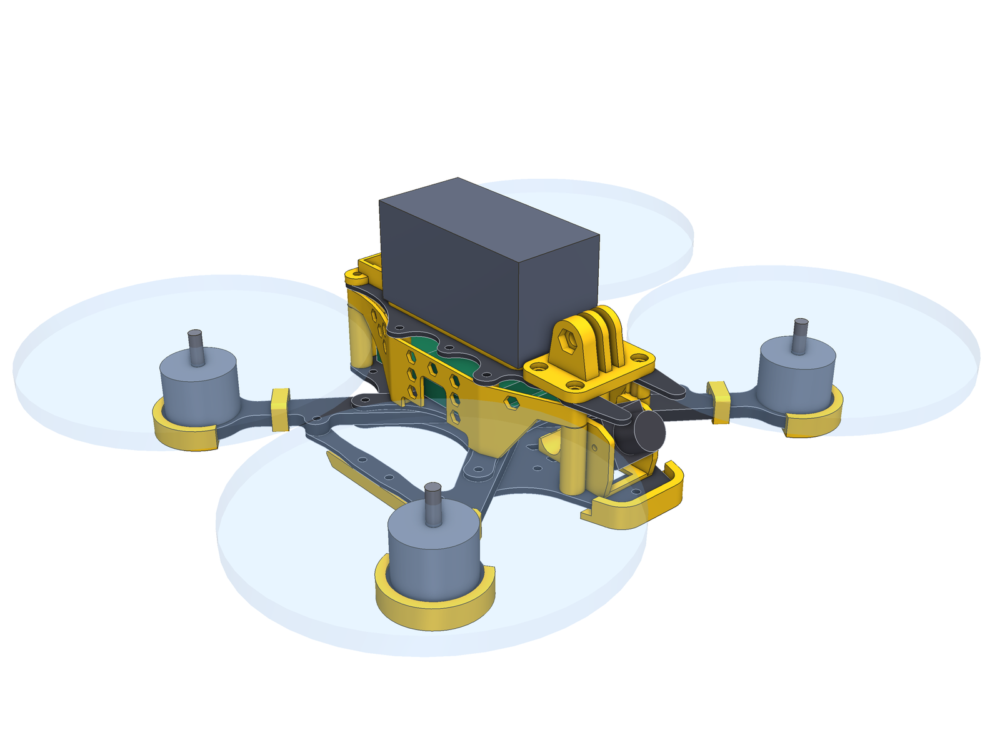
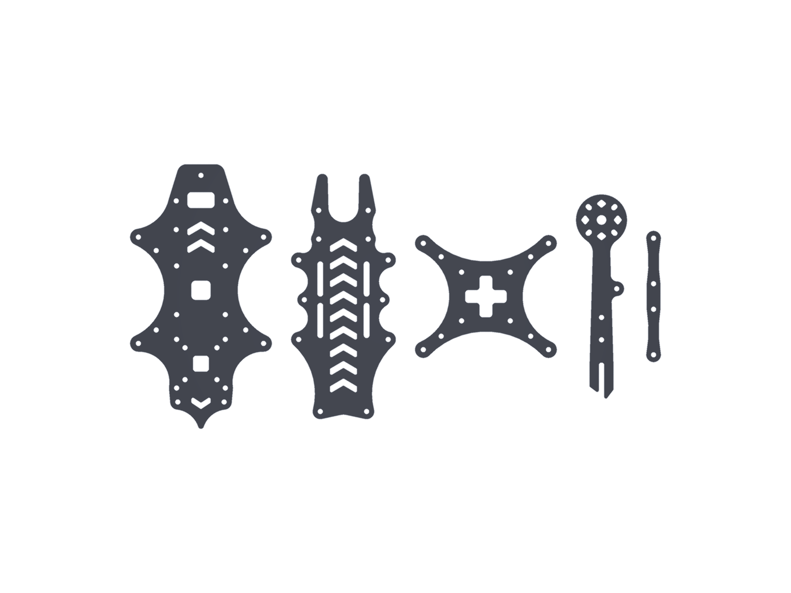
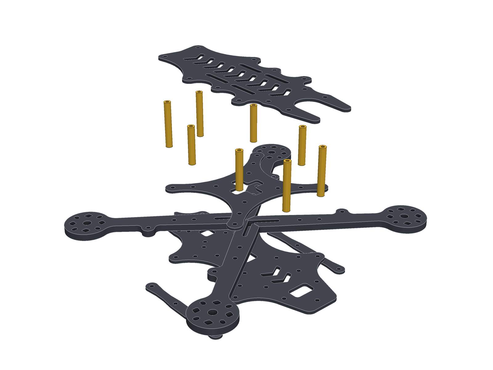
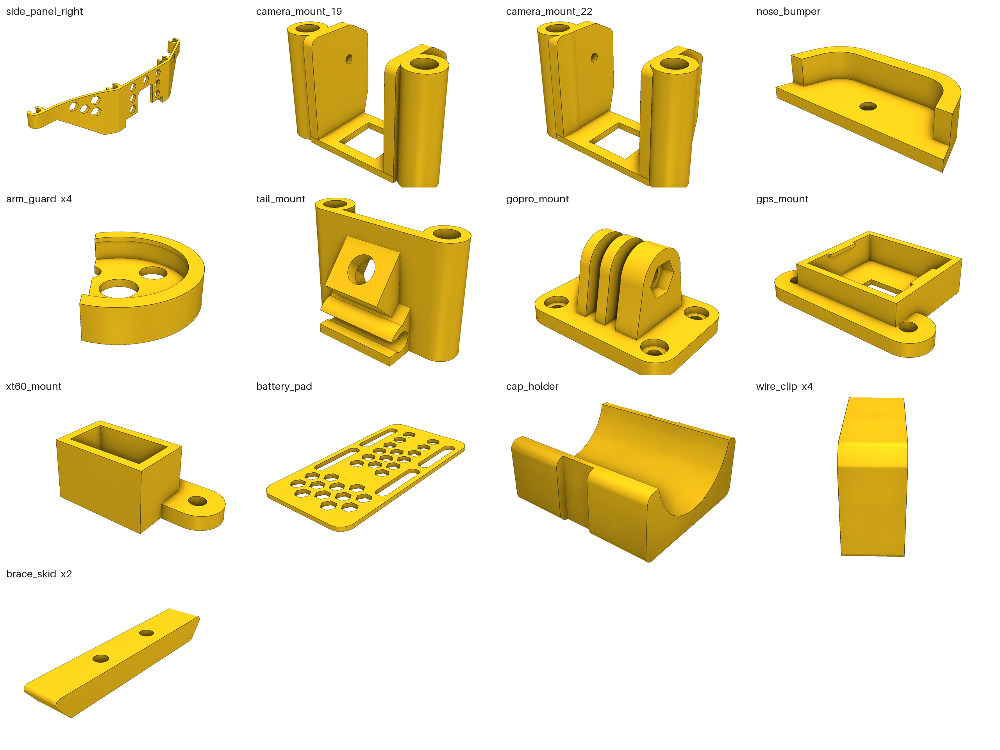
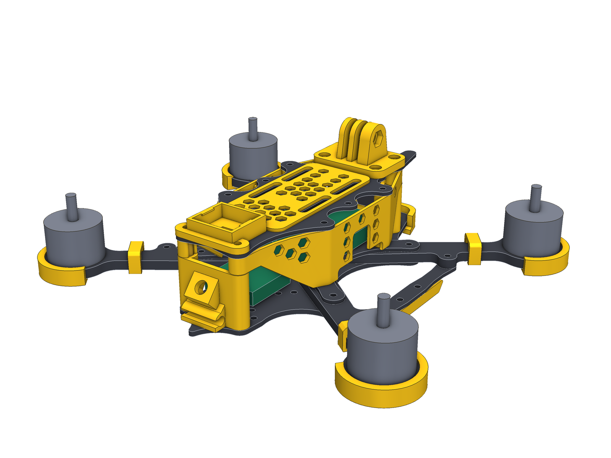

# Zhalo 5" («Жало»)

Рама для 5-дюймового FPV-квадрокоптера у «бджолиному» стилі та комплект аксесуарів під друк із TPU.
Зроблена під **стек SpeedyBee F405 (30.5×30.5)**, **аналоговий VTX** і **камеру 19 мм** (є варіант під 22 мм).



Є стильніший варіант на тих самих точках кріплення: [Shershen](../Shershen-5inch).

> **Стан.** Це CAD-модель: геометрія перевірена розрахунками (див. «Що перевірено»), але раму ще
> ніхто не вирізав і не літав. Перед замовленням карбону надрукуй пластини з PLA для примірки.

## Коротко

| | |
|---|---|
| Схема | wide-X, колісна база **225 мм**, мотори на (±88, ±70.1) мм |
| Пропелери | до 5.1"; між кінцями лопатей 46 мм по боках і 10.6 мм спереду-ззаду |
| Карбон | 5 різних деталей, **116 г**: 3 пластини, промінь ×4, розпірка ×2 |
| Стійки | 4 × M3×28 (стек) + 4 × M3×35 (ніс і хвіст), Ø5 |
| Мотори | 22xx / 23xx, кріплення 16×16 M3 |
| Відсік стеку | 28 мм у висоту, між стійками проходить ESC 45.6×44 мм |
| TPU | 12 видів деталей, повний комплект ≈ 61 г |

## Як влаштована рама



Зліва направо: нижня пластина, верхня, середня, промінь, розпірка.

- **Сендвіч.** Корені чотирьох променів затиснуті між нижньою (2.5 мм) і середньою (2 мм) пластинами.
- **Промінь знімається без розбирання стеку.** Його тримають два власні болти; болт стеку проходить
  крізь відкритий паз у корені. Відкрутив два болти — витягнув промінь уздовж осі.
- **Усі чотири промені однакові.** Лівий — це правий, перевернутий іншим боком.
- **Корені впираються один в одного** по осях X і Y (зазор 0.2 мм), тож удар в один промінь частково
  приймають сусідні.
- **Розпірки** з'єднують вуха переднього і заднього променя з кожного боку і не дають променю
  провернутись у корені. У середині розпірки два отвори під лижу.
- **«Жало»** — хвіст нижньої пластини. Він лежить під кріпленням антени і приймає удари об землю.



### Висоти (Z від низу нижньої пластини)

| Шар | Z, мм |
|---|---|
| Нижня пластина | 0 – 2.5 |
| Промені | 2.5 – 7.5 |
| Середня пластина | 7.5 – 9.5 |
| Стійки стеку (28 мм) | 9.5 – 37.5 |
| Стійки носа і хвоста (35 мм) | 2.5 – 37.5 |
| Верхня пластина | 37.5 – 39.5 |

## Електроніка

| Що | Де | Кріплення |
|---|---|---|
| Стек SpeedyBee F405 V3/V4 + ESC | центр, на середній пластині | 30.5×30.5, болти M3×30 знизу крізь увесь сендвіч |
| Аналоговий VTX | задній відсік, на нижній пластині | 20×20 **і** 30.5×30.5, отвори Ø3.2 |
| Камера 19 мм (або 22 мм) | передній відсік | TPU-кріплення на передніх стійках, нахил 15–45° |
| Приймач | передній відсік, між стеком і камерою | двосторонній скотч |
| Батарея | на верхній пластині | 4 прорізи під ремінь 20 мм, TPU-підкладка |
| Антена VTX (SMA) + T-антена ELRS | хвіст | TPU-кріплення на задніх стійках |

## Що замовляти

### Карбон (ЧПУ)

Файли в [`exports/cnc/`](exports/cnc): DXF (мм, лише дуги і відрізки, жодних сплайнів) і STEP.

| Деталь | К-сть | Товщина | Габарит, мм | Маса, г |
|---|---|---|---|---|
| `plate_bottom_2.5mm` | 1 | 2.5 | 89 × 166 | 29.2 |
| `plate_top_2mm` | 1 | 2.0 | 66 × 154 | 16.3 |
| `plate_mid_2mm` | 1 | 2.0 | 89 × 77 | 8.7 |
| `arm_5mm_x4` | 4 | 5.0 | 128 × 32 | 14.6 |
| `brace_2mm_x2` | 2 | 2.0 | 9 × 82 | 1.8 |

Усі внутрішні кути мають радіус ≥ 1 мм (фреза 2 мм), перемички карбону ≥ 2.5 мм.
Отвори під M3 — Ø3.2. Фаски не потрібні.

### Метизи

| Що | К-сть | Куди |
|---|---|---|
| Стійка M3×28, Ø5 | 4 | кути стеку, на середній пластині |
| Стійка M3×35, Ø5 | 4 | ніс і хвіст, на нижній пластині |
| M3×30 + гайка (зі стеку) | 4 | болти стеку |
| M3×16 | 4 | внутрішні болти променів, знизу в стійки 28 мм |
| M3×14 + самоконтрна гайка | 4 | зовнішні болти променів |
| M3×8 | 12 | стійки знизу (4) і зверху (8) |
| M3×12 + самоконтрна гайка | 4 | розпірки до вух променів |
| M3×8 | 16 | мотори |

## Аксесуари з TPU



Файли в [`exports/print/`](exports/print): STL, 3MF і STEP, уже **в положенні для друку**.
Жодна деталь не потребує підтримок.

| Деталь | К-сть | Маса, г | Як кріпиться |
|---|---|---|---|
| `side_panel_left/right` — бічні панелі зі стільниками | по 1 | 6.0 | защіпаються на 4 стійки ззовні, знімаються на зібраному коптері |
| `camera_mount_19` / `_22` — кріплення камери | 1 | 5.7 | втулки на передніх стійках; камера на своїх гвинтах M2 |
| `nose_bumper` — бампер носа | 1 | 3.0 | M3×8 + гайка в отвір на носі |
| `arm_guard` — захист кінця променя | 4 | 2.9 | натягується на промінь, тримається за головки гвинтів мотора |
| `tail_mount` — антени VTX (SMA, 40°) і T-антена | 1 | 5.7 | втулки на задніх стійках |
| `gopro_mount` — кріплення екшн-камери | 1 | 9.1 | 2 × M3×12 у передні стійки, 2 × M3×10 + гайки |
| `gps_mount` — лоток GPS 22×20 | 1 | 2.7 | 2 × M3×12 замість задніх гвинтів верхньої пластини |
| `xt60_mount` — тримач XT60 | 1 | 2.5 | ті самі гвинти, що й GPS: ставиться **або** одне, **або** інше |
| `battery_pad` — підкладка батареї | 1 | 3.8 | два штифти в шеврони верхньої пластини |
| `cap_holder` — сідло конденсатора Ø10 | 1 | 0.7 | стяжка крізь шеврони нижньої пластини |
| `wire_clip` — кліпса проводів мотора | 4 | 0.5 | защіпається на промінь |
| `brace_skid` — посадкова лижа | 2 | 2.4 | 2 × M3×10 + гайки в отвори розпірки |



### Друк

- TPU 95A, сопло 0.4, шар 0.2, 4 периметри, заповнення 25–40 %.
- Стінки в моделях ≥ 1.6 мм. Отвори змодельовані з запасом 0.2 мм на усадку TPU.
- Бічні панелі друкуються **верхнім краєм донизу** (файл уже перевернутий).
- Спочатку надрукуй одну кліпсу проводів і одну бічну панель: за ними видно, чи твій TPU сідає на
  стійку Ø5 і промінь. Якщо туго чи вільно — зміни `FIT` / `CLIP_BORE` у `accessories/kit.py`.

## Порядок складання

1. Нижня пластина → 4 промені → середня пластина. Вставити болти стеку (M3×30) і зовнішні болти променів.
2. Вкрутити внутрішні болти променів у стійки 28 мм. Затягнути все навхрест.
3. Стійки 35 мм на ніс і хвіст. На них надіти `camera_mount` і `tail_mount`.
4. Стек, VTX, камера, проводка. Розпірки на вуха променів.
5. Верхня пластина. Бічні панелі защіпаються останніми.

## Файли

```
exports/
  cnc/        DXF + STEP карбонових деталей
  print/      stl/ 3mf/ step/ друкованих деталей у положенні для друку
  assembly/   Zhalo-5inch.FCStd (FreeCAD), zhalo_frame.step, zhalo_complete.step
  renders/    картинки
  manifest.json   розміри, маси, таблиці отворів, результати всіх перевірок
src/zhalo/    код моделі (build123d)
```

`Zhalo-5inch.FCStd` відкривається у FreeCAD 1.x: групи Carbon, Standoffs, TPU accessories, Equipment.
Це модель для перегляду і вимірювань; джерело правди — код.

## Змінити і перегенерувати

Усі розміри лежать у [`src/zhalo/params.py`](src/zhalo/params.py). Зміни число — перебудується все.

```sh
uv sync                      # Python 3.12, build123d 0.11
uv run zhalo check           # усі перевірки
uv run zhalo export          # exports/ (FCStd — якщо знайдено FreeCAD або задано FREECAD_CMD)
uv run zhalo render          # exports/renders/
uv run pytest -q
```

Приклади: `T_BOTTOM = 3.0` — товстіша нижня пластина; `STACK_STANDOFF_H = 25` — нижчий корпус
(стійки носа і хвоста стануть 32 мм); `MOTOR_X` — ширина wide-X при тій самій базі.

## Що перевірено

`uv run zhalo check` рахує це на точній геометрії (не «на око»):

- жодні дві деталі рами не перетинаються; кожен болт проходить усі свої шари;
- корпус і всі аксесуари стоять ≥ 2.5 мм поза дисками пропелерів 5.1";
- ESC, FC, VTX обох розмірів, камера на всьому діапазоні нахилу і батарея ні за що не чіпляються;
- перемички карбону ≥ 2 мм, радіуси кутів ≥ 1 мм;
- кожен аксесуар: одне тіло, не врізається в раму й електроніку, лягає на стіл пласкою гранню,
  друкується без підтримок, не має стінок тонших за 0.9 мм;
- встановлені разом аксесуари не перетинаються між собою.

## Що НЕ перевірено і де припущення

- **Міцність не рахувалась.** Перерізи взяті з типових 5" рам (промінь 5 мм, 15 → 11 мм).
- **Посадки TPU** залежать від принтера і пластику — тому тестовий друк вище.
- **USB.** Вікно в бічних панелях стоїть по центру стеку на висоті плати FC. Якщо у твоєї ревізії
  F405 роз'єм зміщений — `GATE_Y` у `accessories/side_panel.py`.
- **Розміри електроніки** взяті з опублікованих специфікацій: ESC 45.6×44, FC 41.6×39.4, висота стеку
  18.3 мм, TX800 28×28 мм. Камера, GPS (22×20) і конденсатор (Ø10) — параметри, бо єдиного стандарту немає.
- **Гвинти моторів** — стандартні M3×8: захист променя не лежить під головками, тож довжина різьби
  в моторі не змінюється.
