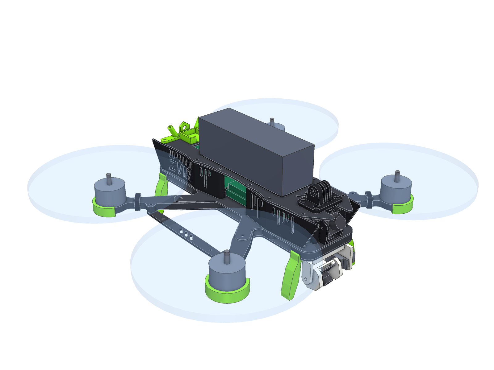
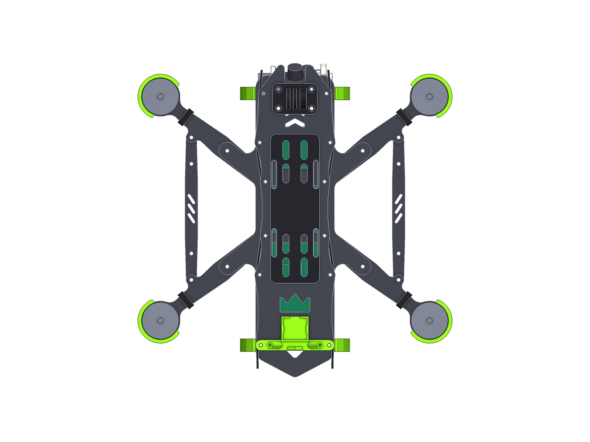
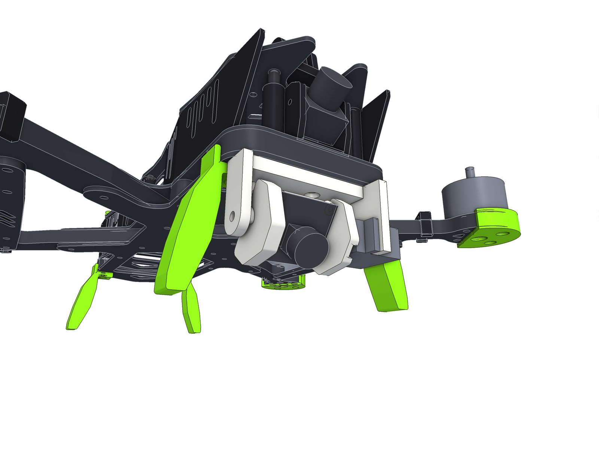
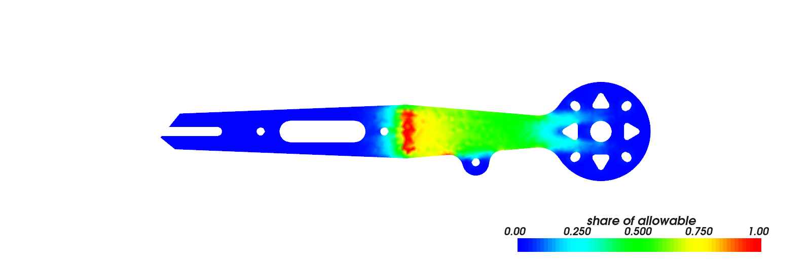

# Zvir 7" («Звір»)

Четверта рама в цьому репозиторії і перша не гоночна: **7-дюймовий носій для комп'ютерного зору**.
Широкий заокруглений корпус із трьома відсіками на одній палубі, окремий відсік під Raspberry Pi або Radxa,
і турель під носом: сервопривод нахиляє другу камеру від горизонту до погляду **прямо вниз**.



> **Стан.** CAD-модель. Геометрія перевірена автоматично (85 перевірок рами, 30 тестів), промінь порахований
> балковою моделлю і методом скінченних елементів. Раму не вирізали, не друкували і не піднімали в повітря.
> Числа міцності порівняльні, а не паспортні (див. «Що перевірено і що ні»).

Усі картинки — кожна деталь окремо і кожна на своєму місці — у [галереї](exports/GALLERY.md).
STL є для всього: карбону (`exports/cnc/`), друкованих деталей (`exports/print/stl/`) і збірок (`exports/assembly/`).

## Коротко

| | |
|---|---|
| Схема | wide-X, база 328 мм, пропелери 7" (177,8 мм) |
| Корпус | 74 × 283 мм, кути R12, хвіст-стріла; три відсіки в ряд на одній палубі |
| Висота відсіків | **35 мм** по всій довжині |
| Промені | **8 мм**, 20 мм на виході із сендвіча, 12 мм біля мотора; між переднім і заднім — розпірка 3 мм |
| Підлога | дві обшивки (2 + 1,5 мм), між ними промені й 8-мм вставки |
| Стійки | **14 однакових** M3×35 |
| Карбон | 8 різних деталей, **316 г** (важка рама — свідомо, див. розділ 4) |
| Друк | 18 видів деталей: TPU ≈ 122 г, PETG (турель) ≈ 17 г |
| Турель | одна вісь, **+15° … −90°**, пряма передача від 9-г серво |
| Комп'ютер | плати 85 × 56 мм (Raspberry Pi 3/4/5, Radxa ROCK 3C/4C+/5C) або Zero (65 × 30 мм) |

## 1. Що просили і що вийшло

| Вимога | Рішення |
|---|---|
| Заокруглена | Корпус — прямокутник із кутами R12, верхня пластина з увігнутими боками, жодного гострого кута в карбоні (найменший радіус 1 мм) |
| Багато місця під FC і Radxa / Raspberry | Задній відсік 98 × 59 × 35 мм тільки під комп'ютер, стек окремо в центрі. Над платою лишається 12,1 мм під вентилятор чи HAT |
| Багато місця під камеру і серво | Камера комп'ютерного зору винесена **під ніс**, а не втиснута в корпус: там їй нічого не заважає ні рухатись, ні бачити |
| Нахил камери вниз | Турель: від +15° над горизонтом до −90°. У крайньому нижньому положенні об'єктив дивиться повз передню кромку рами |
| 7 дюймів | База 328 мм, між кінцями лопатей 74 мм поперек і 32 мм уздовж |
| Елегантні й агресивні лінії | Панелі зі скошеними «рогами» спереду і «плавниками» ззаду, хвіст-стріла, промені з розпірками в один трикутник |
| Графіті | «Патьоки фарби» — прорізи в панелях, що стікають від верхнього краю (вони ж вентиляція); тег **ZVIR**, втоплений у задні панелі; корона у верхній пластині й корона-тримач антен на хвості; кислотно-зелений акцент |
| Брутальна, монструозна, суцільна | Промені 8 мм, 14 стійок, чотири лапи-пазурі по 45 мм, «ікла» в моторних майданчиках, сліди пазурів у розпірках |

З чотирьох фото-референсів узято:

1. **H-рама з гранованим корпусом і бічними рейками** → бічні розпірки між променями як «рейки» з графікою.
2. **Гоночна рама зі стрілоподібними променями і трикутними вирізами** → трикутні «ікла» в моторних майданчиках, хвіст-стріла.
3. **Рама з кутастими TPU-панелями і кріпленням GoPro** → скошені панелі з прорізами, штатне кріплення екшн-камери зверху.
4. **Рама з високими бічними стінками** → високий (35 мм) корпус, закритий панелями з обох боків.

## 2. Компонування



Початок координат — центр стека. +Y — ніс.

| Відсік | Де (Y, мм) | Що в ньому |
|---|---|---|
| Носовий | +30 … +125 | FPV-камера 19 або 22 мм між передніми стійками; аналоговий VTX 20×20 або 30,5×30,5; близько 37 мм вільної палуби між ними (приймач, BEC); вікно в палубі для шлейфа і дроту серво |
| Центральний | −25 … +25 | Стек 30,5 × 30,5 (SpeedyBee F405 + ESC 4-в-1). Відкритий з боків: сюди заходять дроти моторів і тут USB польотного контролера |
| Задній | −128 … −30 | Комп'ютер на TPU-лотку. Роз'єми USB і Ethernet — до хвоста, SD-карта — до стека |
| Зверху | −70 … +70 | Батарея до 46 × 140 мм (6S 3000–4000 мА·год або 6S2P 21700), перед нею екшн-камера, за нею GPS і антени |
| Під носом | +97 … +136 | Турель із серво і камерою |

Висоти (Z = 0 — низ нижньої обшивки):

| Рівень | Z, мм |
|---|---|
| Лапи на землі | −45 |
| Найнижча точка турелі (дивиться вниз) | −36,5 |
| Вісь нахилу турелі | −21,5 |
| Нижня обшивка / промені / палуба | 0 … 2 / 2 … 10 / 10 … 11,5 |
| Відсіки | 11,5 … 46,5 |
| Лопаті (смуга, з прогином) | 28 … 44 |
| Верхня пластина | 46,5 … 48,5 |

Про комп'ютер варто знати:

- Плата стоїть на чотирьох стовпчиках TPU, 5 мм над палубою. Під нею в палубі вікно для повітря.
- **Живлення — через GPIO** (5 В від BEC). USB-C і HDMI на Raspberry Pi дивляться вліво і закриті лівою задньою панеллю; панель знімається без інструмента.
- Плати 100 × 72 мм (ROCK 5B, Orange Pi 5 Plus, носії Jetson) **не влазять**: між середніми стійками 61 мм.
- Хвіст-стріла лежить під штекерами USB і бере на себе удар, який інакше прийшовся б на них.

## 3. Турель



Три жорсткі деталі з PETG (не TPU: камеру на м'якому кріпленні неможливо відкалібрувати):

| Деталь | Що робить |
|---|---|
| **Кронштейн** | Кріпиться під носом трьома болтами M3: два — ті самі, що тримають передні стійки, третій — із гайкою на палубі. Ліва стінка тримає серво, права щока — вісь |
| **Люлька** | Тримає плату камери 25 × 24 мм на чотирьох стовпчиках M2. Ліва стінка надівається на качалку серво, права — на гвинт M3 у щоці |
| **Розпірне кільце** | С-подібна шайба на гвинт осі. Вибирає 2 мм зазору, потрібного, щоб насунути люльку на качалку, тому ставиться останньою |

Що перевірено в коді (`zvir check`):

- Люлька з камерою проходить **увесь хід +15° … −90° нічого не зачіпаючи**; найменший зазор до кронштейна 2,2 мм.
- У конусі зору 76° (по діагоналі) **немає жодної деталі квадрокоптера** на кутах 0°, −45° і −90°: ні лап, ні променів, ні моторів.
- Турель завжди вище за лапи щонайменше на 8,5 мм.

Обмеження, про які треба знати заздалегідь:

- **Одна вісь, без стабілізації.** Це нахил камери, а не підвіс. Серво тримає кут, але не гасить коливання рами.
- **Пряма передача від 9-г серво** (клас SG90 / MG90S). Люфт редуктора серво — це люфт камери. Для вимірювань краще серво з металевим редуктором.
- Люлька зроблена під плату **25 × 24 мм з отворами 21 × 12,5 мм** (Raspberry Pi Camera Module 2 / 3 і сумісні). Інша камера — інша люлька; кронштейн лишається.
- Камера зміщена на 11,5 мм праворуч від осі рами: ліворуч від неї лежить серво. Для калібрування це просто відома константа.
- Порядок складання: кронштейн → серво → качалка → люлька → гвинт осі → кільце. Серво закриває лівий болт кронштейна, тому кронштейн прикручується першим.

## 4. Розрахунок променя

### Що виявилось

Перший варіант був «як у Strila, тільки довший»: промінь 6 мм, 24 → 14 мм. Скінченні елементи показали
для нього першу власну частоту **203 Гц** із мотором і пропелером 62 г на кінці. 203 Гц — це 12 200 об/хв:
середина газу 7-дюймового мотора, тобто саме той режим, у якому літає носій камери. Промінь резонував би
там, де від нього найбільше потрібен спокій.

Балкова модель (`zhalo.structure`), вільна частина променя без моторного майданчика:

| Варіант | Маса, г | Сила до руйнування, верт. / бічна, Н | Жорсткість верт., Н/мм | Частота, Гц |
|---|---|---|---|---|
| 6 мм, болт на 56 мм, 24 → 14 (перший варіант) | 9,6 | 1100 / 4224 | 140 | 238 |
| 6 мм, болт на 62 мм, 24 → 14 | 8,6 | 1191 / 4478 | 178 | 269 |
| 8 мм, болт на 56 мм, 20 → 12 | 10,8 | 1630 / 3980 | 278 | 335 |
| **8 мм, болт на 62 мм, 20 → 12 (обрано)** | **9,6** | **1765 / 4243** | **354** | **379** |
| 8 мм, болт на 62 мм, 24 → 14 | 11,4 | 2118 / 5970 | 422 | 413 |

Обраний варіант важить у вільній частині стільки ж, скільки перший, тримає таке саме бічне навантаження,
на 60 % більше вертикального і має в 2,5 раза вищу жорсткість. Ціна — товщий лист і 4 г на промінь
(36,5 проти 32,4 г): корінь і моторний майданчик теж стали товщими.

### Скінченні елементи на реальній формі

`zhalo.fea`: 3D, ортотропний карбон 0/90 (E = 60 ГПа, G₁₂ = 4,5 ГПа), промінь затиснутий з обох боків
під «ногами» обшивок, навантаження прикладене до стінок отворів під гвинти мотора.

| | 6 мм (перший варіант) | **8 мм (обрано)** |
|---|---|---|
| Вертикальна сила до 600 МПа | 1037 Н | **1552 Н** |
| Бічна сила до 600 МПа | 3939 Н | **3859 Н** |
| Жорсткість верт. / бічна | 120 / 977 Н/мм | **292 / 1021 Н/мм** |
| Перша власна частота (мотор 62 г) | 203 Гц | **310 Гц** |
| Що це в обертах мотора | 12 200 об/хв | **18 600 об/хв** |
| Маса променя | 32,4 г | **36,5 г** |



Як це читати:

- **Балкова модель завищує частоту приблизно на 15 %** (238 проти 203 Гц для першого варіанта): вона не бачить податливості затиску. Тому в таблиці вище вірте різниці між рядками, а абсолютні числа беріть із FEA.
- Розпірки в розрахунок **не входять**: рахується один промінь. Вони додають жорсткості в площині рами, тож бічні числа — оцінка знизу. На вертикальну частоту плоска розпірка майже не впливає.
- 600 МПа — обережна межа для тканини 0/90 **уздовж волокон**. Промені треба різати вздовж волокон; під 45° міцність у рази менша.
- Тяга мотора 2807 на 6S — близько 20 Н. Запас за статичною міцністю величезний; розмір променя визначає частота, а не сила.

## 5. Що замовляти

### Карбон

| Деталь | Товщина | Кількість | Файл |
|---|---|---|---|
| Нижня обшивка | 2 мм | 1 | `cnc/plate_bottom_2mm.dxf` |
| Палуба | 1,5 мм | 1 | `cnc/plate_mid_1.5mm.dxf` |
| Верхня пластина | 2 мм | 1 | `cnc/plate_top_2mm.dxf` |
| Промінь | **8 мм** | 4 | `cnc/arm_8mm_x4.dxf` |
| Розпірка | 3 мм | 2 | `cnc/brace_3mm_x2.dxf` |
| Вставка носа | 8 мм | 1 | `cnc/core_nose_8mm.dxf` |
| Вставка хвоста | 8 мм | 1 | `cnc/core_tail_8mm.dxf` |
| Шайба-вставка під середню стійку | 8 мм | 4 | `cnc/puck_8mm_x4.dxf` |

Чотири товщини листа: 1,5, 2, 3 і 8 мм. Усі контури — тільки дуги й відрізки, найвужча перемичка 2,29 мм,
найменший радіус 1 мм (фреза 2 мм).

### Метизи

| Що | Скільки | Куди |
|---|---|---|
| Стійка M3×35, кругла, Ø5 | 14 | усі на палубі |
| M3×35 + гайка | 4 | болти стека крізь підлогу 11,5 мм |
| M3×16, напівкругла головка | 8 | внутрішні болти променів (4) і середні стійки (4) |
| M3×18 | 4 | носові й хвостові стійки, крізь лапу |
| M3×20 | 3 | кронштейн турелі (третій — із самоконтрною гайкою) |
| M3×16 + самоконтрна гайка | 8 | зовнішні болти променів (4), розпірки (4) |
| M3×8 | 14 | верхня пластина |
| M3×12 | 16 | мотори: промінь 8 мм, у моторі лишається 4 мм різьби — **звірте з глибиною різьби вашого мотора** |
| M3×10 | 1 | вісь турелі |
| M3×6 + гайка | 2 | лоток комп'ютера |
| M2,5×6 самонарізні | 4 | плата комп'ютера |
| M2×5 самонарізні | 4 | плата камери |

### Під що розраховано

Мотори 2806.5 / 2807 (отвори 19 × 19 мм, M3), пропелери 7", стек 30,5 × 30,5, батарея до 46 × 140 × 46 мм.
Орієнтовна злітна маса з Raspberry Pi 4 і батареєю 6S 3300 мА·год — **близько 1,35 кг** (оцінка, не зважено).

## 6. Друк

| Деталь | Матеріал | Кількість | Маса, г (одна) | Розмір на столі, мм |
|---|---|---|---|---|
| `panel_front_right` — Side panel, front right | TPU 95A | 1 | 9,8 | 13 × 109 × 35 |
| `panel_front_left` — Side panel, front left | TPU 95A | 1 | 9,8 | 13 × 109 × 35 |
| `panel_rear_right` — Side panel, rear right | TPU 95A | 1 | 11,2 | 13 × 129 × 35 |
| `panel_rear_left` — Side panel, rear left | TPU 95A | 1 | 11,2 | 13 × 129 × 35 |
| `turret_bracket` — Turret bracket | PETG | 1 | 11,4 | 57 × 36 × 28 |
| `turret_cradle` — Turret camera cradle | PETG | 1 | 5,5 | 34 × 27 × 18 |
| `turret_spacer` — Turret pivot spacer | PETG | 1 | 0,1 | 7 × 9 × 2 |
| `talon_front` — Talon (front leg) | TPU 95A | 2 | 6,5 | 28 × 51 × 12 |
| `talon_rear` — Talon (rear leg) | TPU 95A | 2 | 6,3 | 26 × 51 × 12 |
| `sbc_tray` — Companion-computer tray, 58 x 49 mm boards | TPU 95A | 1 | 4,4 | 56 × 67 × 5 |
| `sbc_tray_zero` — Companion-computer tray, 58 x 23 mm boards *(варіант)* | TPU 95A | 1 | 6,2 | 52 × 67 × 5 |
| `camera_mount_19` — Camera mount, micro 19 mm | TPU 95A | 1 | 5,7 | 40 × 18 × 27 |
| `camera_mount_22` — Camera mount, mini 22 mm *(варіант)* | TPU 95A | 1 | 5,1 | 40 × 18 × 27 |
| `crown` — Crown (GPS tray and antenna holder) | TPU 95A | 1 | 5,7 | 74 × 32 × 19 |
| `arm_guard` — Arm guard | TPU 95A | 4 | 4,3 | 39 × 41 × 11 |
| `battery_pad` — Battery pad | TPU 95A | 1 | 10,0 | 46 × 140 × 3 |
| `wire_clip` — Motor-wire clip | TPU 95A | 4 | 0,6 | 21 × 21 × 6 |
| `gopro_mount` — Action-camera mount (GoPro prongs) | TPU 95A | 1 | 9,1 | 42 × 29 × 23 |

TPU 95A, сопло 0,4 мм; турель — PETG або ASA, 4 периметри. Кожна деталь лягає на стіл пласкою гранню
і друкується без підтримок — це теж перевіряється в коді (площа нависань рахується по сітці).
Лапи — пружини: 4 периметри і заповнення від 40 %.

## 7. Код

Рама працює на рушії [Zhalo](../Zhalo-5inch) зі своїми розмірами (`src/zvir/sizing.py`), своїми карбоновими
профілями (`profiles.py`), своїм корисним навантаженням (`payload.py`: комп'ютер, серво, камера) і своїми
друкованими деталями (`accessories/`).

```bash
cd Zvir-7inch
uv sync
uv run zvir check      # усі геометричні перевірки
uv run zvir analyse    # балкова модель + FEA (потрібна системна libGLU: apt install libglu1-mesa)
uv run zvir all        # exports/: DXF, STEP, STL, 3MF, FreeCAD, рендери, галерея
uv run pytest
```

Змінити плату камери, хід турелі чи висоту лап — це константи на початку `payload.py` і `accessories/talon.py`;
після зміни `zvir check` скаже, чи все ще нічого не зачіпається.

## Що перевірено і що ні

**Перевірено кодом:** кожна деталь — одне суцільне тіло; деталі не перетинаються між собою і з електронікою;
кожен болт проходить усі шари; стійки стоять на карбоні; корпус і всі друковані деталі поза дисками пропелерів
із запасом 2,5 мм; обидві FPV-камери проходять увесь діапазон нахилу; турель проходить увесь свій хід;
перемички в карбоні ≥ 2 мм; друк без підтримок і без стінок тонших за 0,9 мм.

**Не перевірено:**

- Нічого не виготовлено. Посадки TPU (кільця на стійках, лапи) взяті з правил, які працюють для TPU 95A, але на цій рамі їх ніхто не міряв.
- Розміри серво SG90, Raspberry Pi і камери взяті з їхніх типових креслень. **Серво цього класу різних виробників відрізняються на пів міліметра** — зміряйте своє перед друком кронштейна.
- Частота 2807-го мотора на крейсерському газі взята як 9–13 тис. об/хв — це типова оцінка, не вимір.
- FEA рахує один промінь, жорстко затиснутий у сендвічі; реальний затиск м'якший, тож реальна частота буде трохи нижчою за розрахункову.
- Міцність лап (TPU, 45 мм) порахована лише як стійка на стиск; на жорстку посадку з бічною швидкістю їх ніхто не перевіряв.
